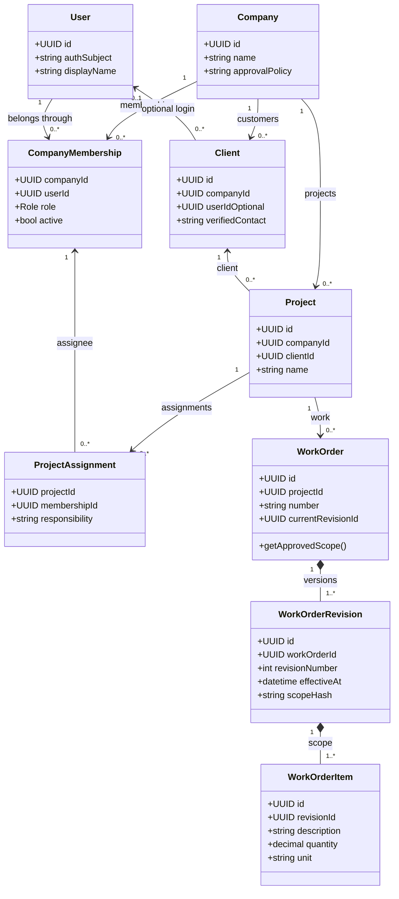
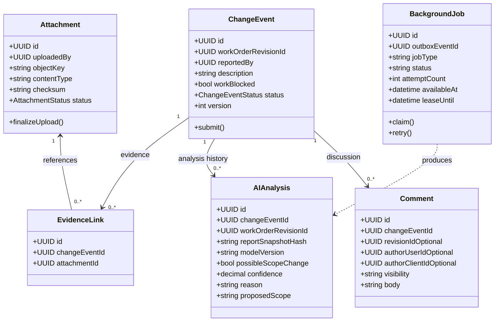
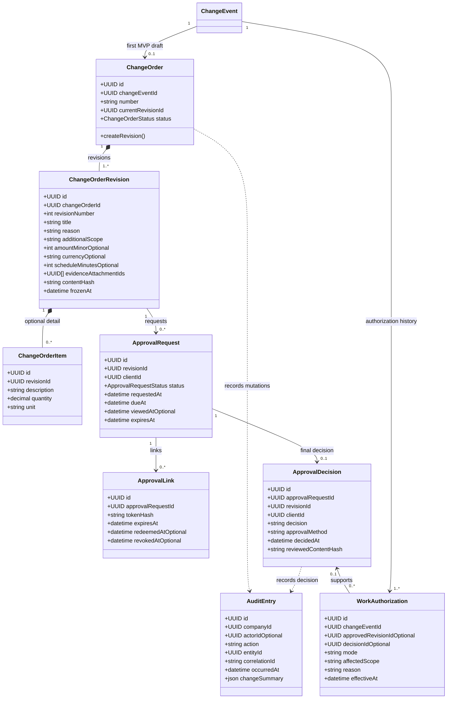
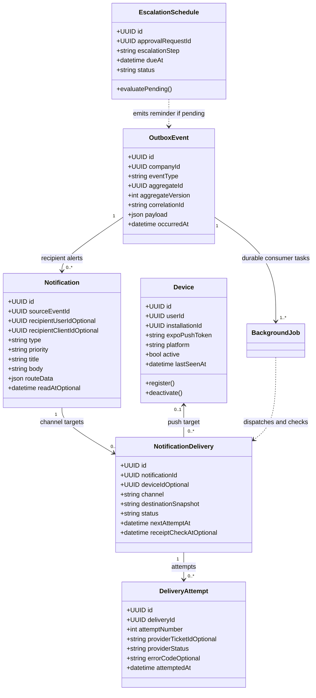
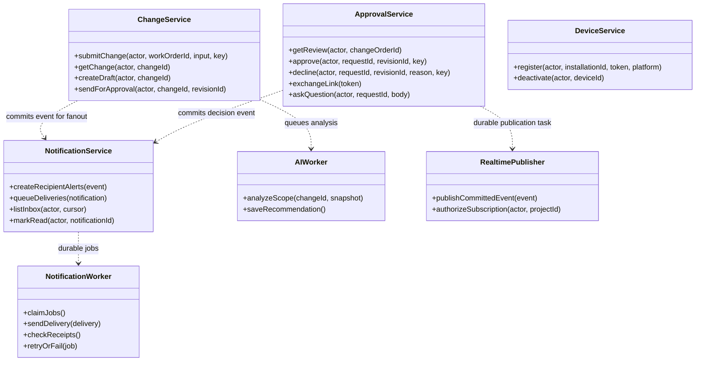
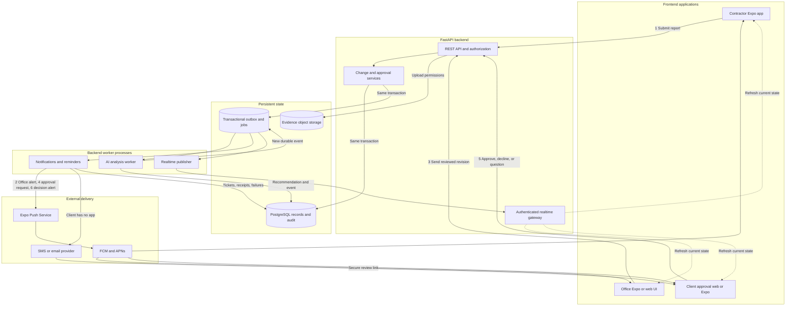
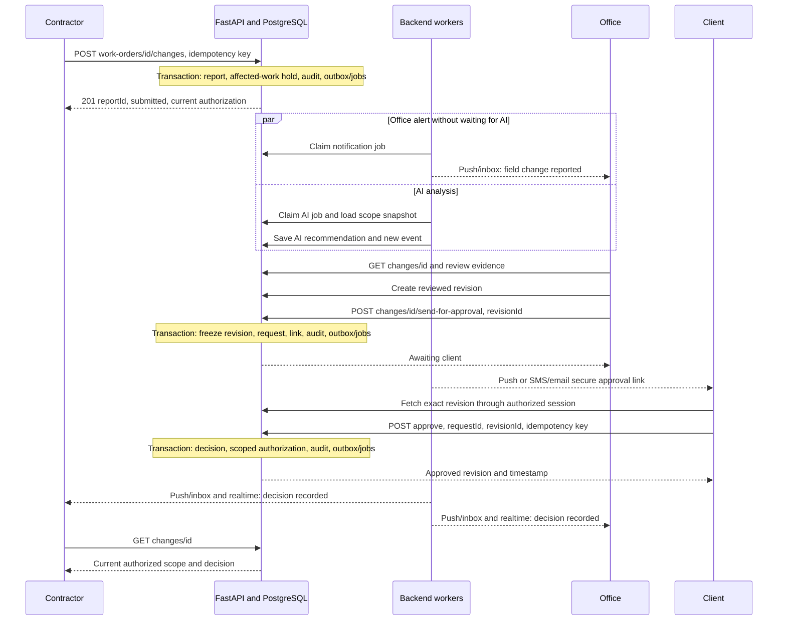
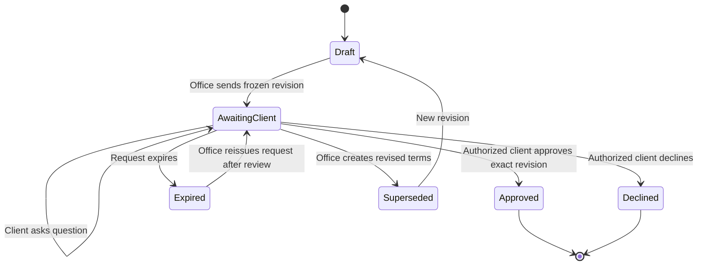

# ChangeOrder App

SDSU's AI club ChangeOrder App is an open source AI-assisted order management system that detects deviations from the approved scope of contracted work, helps contractors document changes, by sending important changes to office for review, and to the client for immediate approval.

## Collaborators

### SDSU AI CLUB MEMBERS

- Aadi Bery (sdsuaiclub@gmail.com)
- Jaylan Luong (jluong5067@sdsu.edu)
- Uriel Zacarias (urielzacarias@gmail.com)
- Tad Schiller (tad@zacksmithplumbing.com)
- Ajay (arao3465@sdsu.edu)
- Bona O'Quinn (boquinn1053@sdsu.edu)

Proposed design: Expo/React Native + FastAPI + PostgreSQL

This document turns the agreed first pipeline into an implementation model: field report -> office review -> client decision -> contractor authorization.

## 1. Boundaries and conventions

- **Mobile:** screens, evidence capture, authenticated REST calls, device registration, notification taps, live status updates.
- **Client web:** a focused review/approve/decline/question page; an installed app is optional.
- **FastAPI:** identity, tenant/project access, workflow transitions, exact-revision approval, work authorization, audit history, and durable job creation.
- **Workers:** asynchronous AI analysis, notification fan-out/delivery/receipts, reminders, and realtime publication. These are processes in the same backend codebase, not separate business microservices.
- **PostgreSQL:** authoritative records and durable work queue. Object storage holds photo/document bytes.
- UUIDs identify records; labels such as WO-1048 and CO-123 are display numbers. Store UTC timestamps and display local time. Every tenant-owned record has companyId; all linked records must belong to the same company.
- Money, if enabled, uses integer minor units plus currency. Pricing is optional and entered/reviewed by office staff; this design does not require an AI pricing engine.
- UML methods below show responsibilities. Business mutations execute through application services, which authorize and commit the complete transaction.

## 2. UML identity, assignment, and original scope



**Roles:** company_admin, office, contractor. Client authority comes from the client's relationship to the project and its approval policy, not from a user-supplied role field. Memberships allow one user to work in multiple companies. Assignments determine which office users receive a report and which contractors receive a decision.

WorkOrderRevision preserves the exact original scope used for an AI comparison; replacing the current work order must not rewrite an older report's reference.

## 3. UML



AIAnalysis contains a recommendation, never a client decision or an authorization. Record the report and scope versions used. A failed AI job leaves the report available for manual office review. Evidence uploads have pending/ready/rejected states; only ready attachments from the same company may be attached to a report. Upload bytes separately, then submit attachment IDs.

Comment.visibility distinguishes internal discussion from client-visible questions. Client-linked requests must never expose internal notes or raw AI prompts.

## 4. UML — revisions, approvals, and authorization



The first MVP has one designated approver per revision. Multiple approvers, thresholds, and consolidated changes can be added later. Reissuing an expired request creates a new request and cancels any earlier pending request for that revision.

**Rules that must be enforced by the backend:**

1. A report creates an initial authorization record under company policy. For the MVP, hold the reported additional work until approval; do not automatically stop unrelated approved work.
2. AI cannot release the hold. The client approves the exact frozen ChangeOrderRevision, including its scope, schedule, evidence references, and amount if pricing is enabled.
3. Editing a sent revision creates a new revision and cancels outstanding approval requests/links for the superseded content. An approved revision remains historical; changing its authorized work requires a new decision.
4. Approval/decline locks the current order and request, verifies client/project access and revision, records one final decision, updates authorization, appends audit entries, and creates outbox events in one database transaction.
5. Repeated identical commands return the stored result; a conflicting decision, stale revision, or expired/canceled request returns HTTP 409 or 410 as appropriate.
6. A notification is an alert. The phone fetches current server state before showing work authorization. A delayed push cannot grant permission.
7. Approval links store only a token hash. Exchange the token for a short-lived session scoped to one request. GET/read never approves or consumes the decision; the explicit decision POST does. Exchange does not approve or permanently consume the link; keep it redeemable until a final decision, revocation, or expiry. redeemedAt records the first successful exchange.
8. A bearer link demonstrates control of the link. If the company needs stronger identity verification, require a verified-contact OTP before enabling decisions, and record the method actually used.
9. WorkAuthorization.mode retains the API values stop/continue/limited, but applies only to affectedScope. An authorization history entry is appended on change rather than overwriting earlier authorizations.
10. Audit records are append-only to application roles. Database permissions and retained backups enforce that policy; a class named AuditEntry alone does not make data immutable.

Emergency authorization is a later, separate office/admin command with explicit scope, reason, actor, and expiry. It must not appear as a client-approved decision.

## 5. UML notification and delivery objects



Keep these concepts distinct:

| Object/status             | Meaning                                                          |
| ------------------------- | ---------------------------------------------------------------- |
| Notification              | One logical recipient alert and persistent inbox entry           |
| NotificationDelivery      | One target: a device, verified email, or verified SMS contact    |
| DeliveryAttempt           | One provider send attempt or retry, with a ticket when available |
| Expo ticket accepted      | Expo accepted the request                                        |
| Provider receipt accepted | FCM/APNs accepted the handoff                                    |
| Notification.readAt       | The app recorded the inbox item as read                          |
| ApprovalRequest.viewedAt  | The client opened the actual approval details                    |
| ApprovalDecision          | The client explicitly approved or declined a revision            |

An accepted push ticket/receipt does not prove the user received, viewed, or approved anything. Expo documents this distinction and requires receipt/error handling. [Expo delivery documentation](https://docs.expo.dev/push-notifications/sending-notifications/)

**Delivery policies:** create in-app entries even when no device is available; select SMS/email for clients without the app; retry transient errors with exponential backoff and jitter; disable tokens on DeviceNotRegistered; separate invalid credentials/payload errors from retryable failures; retain dead-letter jobs for office visibility. Deduplicate logical notifications by sourceEventId + recipient + type, deliveries by notification + channel + destination, and jobs by event + consumer. Retried network sends can still duplicate provider delivery, so the client also deduplicates notification IDs.

## 6. Application services and route ownership



These dependencies describe queued work: services insert events/jobs during the transaction; they do not call provider APIs before committing.

## 7. API route map

All REST paths below are prefixed with **/api/v1**. Existing proposed paths are retained. Additional routes fill gaps in uploads, drafting, questions, secure web approval, and notification testing. Role checks also require the correct company and project relationship.

| Method and path                      | Service/function                  | Access                                          | Effect                                                            |
| ------------------------------------ | --------------------------------- | ----------------------------------------------- | ----------------------------------------------------------------- |
| GET /me                              | IdentityService.getCurrentUser    | Signed-in user                                  | Identity, memberships, effective permissions                      |
| POST /devices                        | DeviceService.register            | Signed-in user                                  | Upsert installation/token owned by current user                   |
| DELETE /devices/{id}                 | DeviceService.deactivate          | Device owner                                    | Disable delivery on logout/removal                                |
| GET /work-orders                     | WorkOrderService.listAssigned     | Assigned staff                                  | Paginated work orders                                             |
| GET /work-orders/{id}                | WorkOrderService.get              | Assigned staff                                  | Approved scope/revision and related changes                       |
| POST /attachments/uploads            | AttachmentService.createUpload    | Assigned staff                                  | Pending attachment and short-lived upload URL                     |
| POST /attachments/{id}/complete      | AttachmentService.finalize        | Uploader with project access                    | Verify object metadata/size/type; mark ready                      |
| GET /attachments/{id}/download       | AttachmentService.getDownload     | Authorized viewer                               | Short-lived download URL for allowed evidence                     |
| POST /work-orders/{id}/changes       | ChangeService.submitChange        | Assigned contractor/office                      | Save event, hold, audit, AI and alert jobs; return 201            |
| GET /changes/{id}                    | ChangeService.getChange           | Assigned staff                                  | Report, evidence, analysis, status, current authorization         |
| POST /changes/{id}/change-order      | ChangeService.createDraft         | Assigned office                                 | Create manual draft when AI is absent/failed                      |
| POST /change-orders/{id}/revisions   | ChangeOrderService.createRevision | Assigned office                                 | New draft; cancel superseded pending approval requests            |
| POST /changes/{id}/send-for-approval | ChangeService.sendForApproval     | Assigned office                                 | Freeze selected revision, create request/link, queue client alert |
| GET /change-orders/{id}              | ApprovalService.getReview         | Assigned office/contractor or designated client | Role-filtered current order and revision                          |
| POST /change-orders/{id}/approve     | ApprovalService.approve           | Designated authenticated client                 | Validate request/revision; decision + authorization + outbox      |
| POST /change-orders/{id}/decline     | ApprovalService.decline           | Designated authenticated client                 | Decision + held affected work + outbox                            |
| GET /changes/{id}/comments           | CommentService.list               | Authorized participants                         | Visibility-filtered discussion                                    |
| POST /changes/{id}/comments          | CommentService.create             | Authorized participants                         | Question/comment, audit, recipient notifications                  |
| POST /approval-links/exchange        | ApprovalService.exchangeLink      | Valid unexpired link token                      | Request-scoped, short-lived client web session                    |
| GET /approval-session                | ApprovalService.getSessionReview  | Request-scoped client session                   | Exact frozen revision and allowed evidence                        |
| POST /approval-session/approve       | ApprovalService.approve           | Request-scoped client session                   | Same approval service and transaction as app route                |
| POST /approval-session/decline       | ApprovalService.decline           | Request-scoped client session                   | Same decline service as app route                                 |
| POST /approval-session/questions     | ApprovalService.askQuestion       | Request-scoped client session                   | Client-visible question; request stays pending                    |
| GET /notifications                   | NotificationService.listInbox     | Signed-in recipient                             | Persistent inbox, cursor pagination                               |
| POST /notifications/{id}/read        | NotificationService.markRead      | Notification recipient                          | Record inbox read time                                            |
| POST /notifications/test             | NotificationService.queueSelfTest | Signed-in user, rate-limited                    | Send only to caller's devices; return 202 with notificationId     |
| GET /changes/{id}/audit              | AuditService.list                 | Assigned office/admin                           | Audit timeline excluding secrets                                  |
| WS /realtime                         | RealtimeGateway.subscribe         | Signed-in staff/client with scoped permissions  | Authorized event hints; fetch REST state on update/reconnect      |

Authentication should use a standard OIDC identity provider. Expo supplies access tokens; FastAPI validates issuer, audience, signature and expiry. /me maps the subject to local membership/project permissions. Login/token refresh occur with the chosen provider rather than requiring a new custom password service. Web approval sessions use Secure/HttpOnly/SameSite cookies and CSRF protection for mutations.

**Mutation contract:** Idempotency-Key is required for report submission, send-for-approval, and decisions. Store caller scope, route, request hash, and response atomically with the mutation. Same key/different body returns conflict. Decision payloads include approvalRequestId and revisionId. Tenant/user IDs and authority are derived from verified identity, not trusted from payloads.

## 8. Architecture — notification and approval emphasis



The two persistence nodes represent logical tables in the **same PostgreSQL database**, allowing one transaction. Initial report alerts go to office staff immediately after commit, independently of AI latency. Client requests are sent only after office review. Client decisions update the authoritative state immediately; push/realtime delivery continues asynchronously.

PostgreSQL SKIP LOCKED supports avoiding row contention between queue consumers. Claim a job in a short transaction, set a recoverable lease, commit, then do external I/O outside the lock. Retry expired leases; acknowledge only the claimed job, not every consumer of the event. [PostgreSQL SELECT documentation](https://www.postgresql.org/docs/current/sql-select.html)

If multiple API instances are added, distribute realtime hints through a shared mechanism such as PostgreSQL LISTEN/NOTIFY alongside the durable outbox; do not rely on one process's in-memory connection list. Realtime is a hint, not durable state. FastAPI supports WebSockets directly. [FastAPI WebSocket documentation](https://fastapi.tiangolo.com/advanced/websockets/)

## 9. Sequence — first complete change



Receipt processing, retries, and pending-request reminders run independently. A client question notifies office staff and retains the pending request. If the answer changes the terms, office issues a new revision. A decline keeps the proposed additional work held and alerts contractor/office.

## 10. Approval state machine



This diagram describes a revision's approval lifecycle. The order keeps its revision history. Expiry cancels links/reminders and preserves the hold; reissue creates a new request. There is no automatic approval timeout. Approved historical content is never edited into a different authorized scope.

## 11. Events, recipients, and reminders

| Committed event           | Recipients                                          | Channel policy                                               | Navigation                     |
| ------------------------- | --------------------------------------------------- | ------------------------------------------------------------ | ------------------------------ |
| change.submitted          | Assigned office; contractor gets confirmation inbox | Immediate office push + inbox                                | Change details                 |
| change.analysis_completed | Office                                              | Realtime/inbox; avoid duplicate push unless policy warrants  | Change review                  |
| change.analysis_failed    | Office                                              | Inbox/realtime; manual review available                      | Change review                  |
| approval.requested        | Designated client                                   | Push + inbox if installed; otherwise verified SMS/email link | Exact approval revision        |
| approval.question_created | Assigned office                                     | Push + inbox                                                 | Client-visible discussion      |
| approval.approved         | Reporting contractor and assigned office            | Push + inbox + realtime                                      | Current server authorization   |
| approval.declined         | Reporting contractor and assigned office            | Push + inbox + realtime                                      | Current server hold and reason |
| approval.reminder_due     | Client or escalation recipient                      | Policy-selected channel, only while pending                  | Approval review                |
| approval.expired          | Assigned office and contractor                      | Inbox/realtime; priority based on work blockage              | Held change                    |

Example configurable escalation: client reminder after 15 minutes, office escalation after 30, project manager after 60. These are proposed policy settings, not delivery guarantees. Cancel/revalidate schedules after approval, decline, cancellation, or supersession; recheck immediately before dispatch. A send already in flight may arrive late, so the link and app must resolve to current state.

Example **push data**, with no approval secret:

```json
{
  "notificationId": "uuid",
  "eventId": "uuid",
  "type": "approval.requested",
  "changeEventId": "uuid",
  "changeOrderId": "uuid",
  "approvalRequestId": "uuid",
  "revisionId": "uuid",
  "aggregateVersion": 4
}
```

The app validates allowed event types and IDs, waits for authentication/navigation readiness, then maps them to a known route. Handle foreground events and cold-start notification taps; fetch REST state on resume and after reconnect. Device registration happens after sign-in, includes a stable installation ID, updates token rotation, and disables old ownership on logout/account switch.

## 12. Supporting records and status types

| Record/type                 | Required values or fields                                                                                                   |
| --------------------------- | --------------------------------------------------------------------------------------------------------------------------- |
| IdempotencyRecord           | companyId, actorScope, HTTP method/path, key, requestHash, storedResponse, expiresAt; unique actorScope + method/path + key |
| ChangeEventStatus           | submitted, analyzing, office_review, needs_information, resolved; the related ChangeOrder supplies approval progress        |
| ChangeOrderStatus           | draft, awaiting_client, approved, declined, withdrawn; historical revisions can be superseded                               |
| ApprovalRequestStatus       | pending, approved, declined, expired, canceled                                                                              |
| WorkAuthorization.mode      | stop, continue, limited, each restricted to affectedScope                                                                   |
| BackgroundJob.status        | pending, processing, retry_wait, completed, dead_letter                                                                     |
| NotificationDelivery.status | pending, retry_wait, ticket_accepted, provider_accepted, unavailable, permanent_failure                                     |
| AttachmentStatus            | pending, ready, rejected                                                                                                    |
| EscalationSchedule.status   | pending, dispatched, canceled                                                                                               |

Read models may expose a combined progress label to the UI, but must derive it from these records rather than maintaining a second independently mutable approval status. IdempotencyRecord expiry must exceed the supported client retry/offline window. Final approval uniqueness and historical decisions remain enforced after an idempotency record expires.

## 13. Build order and acceptance checks

**First implementation:** authentication/membership, project assignment, one work order and frozen scope revision, device registration, notification inbox, outbox/jobs, Expo delivery attempts/receipts, and a self-test route. Then report submission, manual office drafting, one designated client approval, authorization/audit, and decision alerts. Add evidence, AI, realtime, and configurable reminders once that path is reliable. AI should never be required to notify the office or process a reviewed approval.

**Later objects:** multi-approver ApprovalPolicy/ApprovalStep, EmergencyAuthorization, daily FieldReport/FieldEvent, offline MobileSubmissionQueue, and cost-estimation models. A generic FieldReport is unnecessary for the first change-only submission because ChangeEvent already captures the report.

| Acceptance scenario                                   | Expected behavior                                                                             |
| ----------------------------------------------------- | --------------------------------------------------------------------------------------------- |
| Phone retries a report after a timeout                | One report, one logical alert per recipient                                                   |
| API exits after report commit                         | Worker resumes durable jobs after restart                                                     |
| AI is slow or unavailable                             | Office is already alerted and can draft manually                                              |
| Office sends revision 2 while revision 1 link is open | Revision 1 decision is rejected; revision 2 needs review                                      |
| Client taps Approve twice                             | One decision and equivalent repeat response                                                   |
| Two conflicting decisions race                        | One final decision; second conflicts                                                          |
| Provider accepts push                                 | Record acceptance; do not claim client receipt/read/approval                                  |
| DeviceNotRegistered appears                           | Disable token; retain inbox and apply channel policy                                          |
| Decision commits but push fails                       | Approval stays recorded; jobs retry and REST reflects truth                                   |
| Mobile reconnects after missing a realtime event      | Refetch restores current authorization                                                        |
| Pending reminder races with approval                  | Revalidation suppresses unsent reminder; late link shows current decision                     |
| User requests another company's order                 | Deny access before reading or mutating data                                                   |
| Link preview/scanner visits approval page             | No approval/decline occurs                                                                    |
| Client declines                                       | Proposed additional work remains held; unrelated original scope follows its own authorization |

## References

- [Expo: sending notifications, tickets, receipts, retries and delivery guarantees](https://docs.expo.dev/push-notifications/sending-notifications/)
- [FastAPI: WebSockets](https://fastapi.tiangolo.com/advanced/websockets/)
- [FastAPI: background tasks and worker considerations](https://fastapi.tiangolo.com/tutorial/background-tasks/)
- [PostgreSQL: SELECT and SKIP LOCKED](https://www.postgresql.org/docs/current/sql-select.html)

All domain objects, API signatures, policies, and workflow choices above are proposed application design decisions; the references support platform behavior rather than mandating this model.
