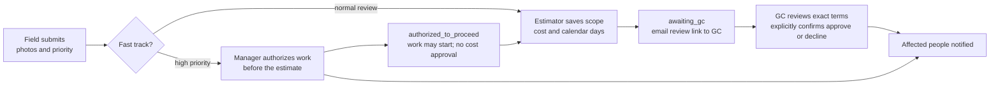
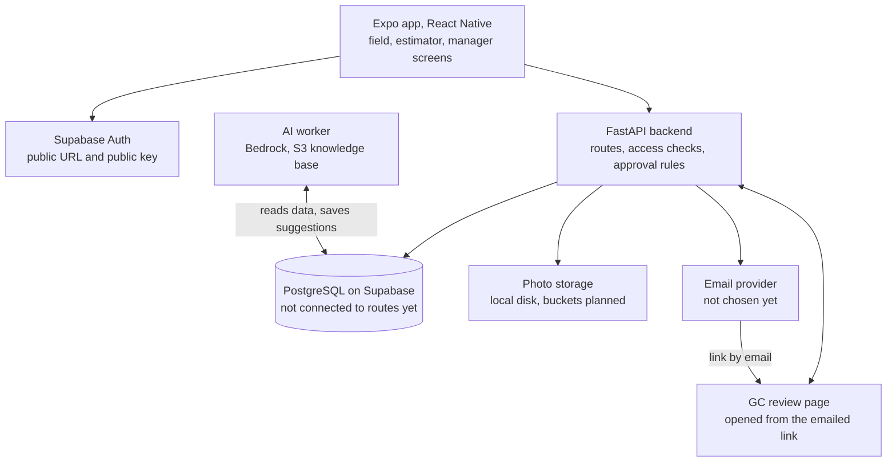
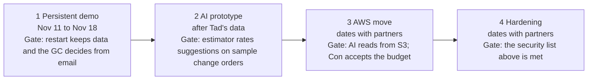

# Change Order: Specification v0.2

**Date:** November 11, 2026; U5 corrections prepared November 14, 2026
**Status:** U5 review corrections for human review. The personas and fast-track rule below follow the Nov 11 team decisions and `AGENTS.md`; partner confirmation remains pending. [SPECIFICATIONS.MD](SPECIFICATIONS.MD) (v0.1, Oct 9) remains the historical design.

## Summary and what changed

Version 0.2 folds in the Nov 4 workflow meeting and the Nov 5 data meeting, and distinguishes the agreed design from implementation status. The implementation snapshot below is checked against `main` after PRs #12, #13, #19 and #21; open PRs are not treated as shipped. Where sources conflict, the conflict is listed under [Open decisions](#open-decisions-and-assumptions) rather than silently resolved. v0.1 stays in the repository as the original design.

The product is unchanged: a field worker photographs a change, the estimator prices it, and a general contractor approves it from an emailed link. What moved is who the people are called, that AI cost estimation is now central, and how approval works for urgent changes.

| Topic | v0.1 (Oct 9) | v0.2 | Source |
| --- | --- | --- | --- |
| Personas | Contractor, office reviewer, client | Field, estimator, manager, GC | Nov 4 meeting |
| Pricing | Out of scope for the MVP | Estimator enters cost; AI suggests a scope check and estimate | Nov 4 meeting |
| Urgent changes | No automatic approval | High priority: manager authorizes work now; estimate and GC approval follow | Oct 20 and Nov 4 meetings |
| Photos | Optional evidence | Multiple photos, context only, not AI input yet | Nov 4 meeting |
| Identity | OIDC provider | Staff sign in with Supabase accounts; GC uses a hashed email token | Oct 20 meeting |
| Storage | Unselected | Private buckets planned; local files in the running prototype | Oct 20 meeting |
| AI | Advisory scope comparison | AWS Bedrock with an S3-backed knowledge base, trained on partner data | Oct 20, Nov 4, Nov 5 meetings |

## Personas

Four personas replace the three in v0.1. Con asked for industry-standard terms because "client" is vague in software. The GC is also external to the app, so it cannot be a normal user. Each company's records are isolated from every other company's.

| Persona | Replaces | What they do | How they get in |
| --- | --- | --- | --- |
| Field | Contractor | A foreman or on-site subcontractor rep. Photographs the change, describes it, sets priority, sees its status | Mobile app, Supabase email/password |
| Estimator | Office reviewer | Reviews the change, checks whether it is in scope, writes the description, requested timeline and proposed cost, and sends it to the GC | App, Supabase email/password |
| Manager | Admin or boss | The estimator's boss. Authorizes high-priority work to start before the estimate | App, Supabase email/password |
| GC | Client | General contractor. Approves or declines the exact proposal. Cannot be required to use the app | Emailed link with a hashed token, no account |

The field worker should know what to photograph, so the capture screen prompts for it. These are the four product personas. Legacy internal identifiers and preview labels remain in the prototype; they do not define additional roles. Staff role and company must come from the server after token verification. The GC uses a browser link without a staff account.

## Workflow and approval rules

Priority decides the path. A normal change goes to the GC. A high-priority change is authorized by the manager so work can start now, because contracts increasingly say a change order cannot affect the timeline. The estimate follows, and the GC still approves or declines the cost afterward, so the price is agreed before it is final. This rule was decided on Nov 11 and should be confirmed with Con.

- The estimator completes description, requested timeline and proposed cost before a normal change reaches the GC. On a fast-track change the cost follows the authorization, and the GC link is sent once it is entered.
- GC approval is external. The app cannot require the GC to sign in, so email is the approval path.
- Every status change notifies the people it affects.
- A timeout never approves a change (carried from v0.1).
- The canonical status set is `submitted`, `in_review`, `authorized_to_proceed` (fast track only), `awaiting_gc`, `approved`, `declined`, `withdrawn`. Legacy `awaiting_client` and `rejected` map to `awaiting_gc` and `declined`; compatibility code is not an extra product status set.
- A manager's authorization is permission to start work, not approval of the cost. Only a GC decision approves or declines the proposal. A normal-priority report cannot use the authorize-now action.
- Cost is integer cents plus currency. Requested timeline is a non-negative whole number of **calendar days**, including zero. A sent proposal revision is immutable; changed terms require a new revision and invalidate its old link.

## Architecture and tech stack

One backend sits between the apps and everything else. The apps never talk to the application database, storage or AI directly, and only the backend holds privileged provider credentials. Staff sign-in is the exception: the app exchanges email/password with Supabase Auth using its public URL and anon/publishable key, then sends the access token to the backend. It does not query tenant tables or decide its own role.

| Layer | Choice | Note |
| --- | --- | --- |
| Front end | React Native with Expo, Tailwind styling | One codebase for iOS and Android; Expo Go on a physical phone avoids Windows emulator limits. Swift was ruled out as iOS only |
| Backend | Python with FastAPI | Built; runs on port 8000 |
| Database | PostgreSQL on Supabase through SQLModel | B2 schema reported applied by Bona; B3/J4 cutover remains unmerged and not live-verified in this review |
| Photos | Local disk in the running backend; private buckets planned | Public `/uploads` is a prototype limitation, not private evidence storage |
| AI | AWS Bedrock with an S3-backed knowledge base | Later; depends on Tad's data |
| Email | Configurable provider; J3 defaults to a Resend-compatible HTTPS payload | Merged with private console-link fallback; real delivery requires configured sender, recipient and provider |
| Hosting | Not selected | Decide after the AI move to AWS |

The repository uses `backend/`, `frontend/` and `scripts/`, not the directory names in v0.1.

## Data model and storage

PostgreSQL on Supabase is the target system of record. Bona reports the B2 migrations applied (13 domain tables plus migration bookkeeping); their PR remains separate from the live project. Existing applied migrations must not be edited or re-run as part of a merge. Fixes need a new reviewed migration owned by Bona. SQLModel's `create_all` does not alter existing tables.

`main` currently persists the prototype workspace in local SQLite, so a restart alone does not prove Supabase integration. B3 (#17), J4 (#22) and the configured `WORKSPACE_BACKEND=postgres` must be integrated and exercised before claiming the full workflow uses Supabase. This review did not inspect or modify the shared database.

| Entity | State | Purpose |
| --- | --- | --- |
| User | B2 schema | Company-scoped person with field, estimator, manager or gc role; staff links to Supabase Auth, GC has no sign-in account |
| ChangeEvent | B2 schema | Original field report with description, priority, canonical status, project, company and authorization fields |
| ChangeOrder | B2 schema | One proposal per field report |
| ChangeOrderRevision | B2 schema | Proposed terms; a sent revision is never edited |
| ApprovalRequest | B2 schema | Request to the GC for one revision |
| ApprovalDecision | B2 schema | One final decision per request |
| Notification | B2 schema | Alert per recipient |
| Company | B2 schema | Boundary that isolates each company's change orders |
| Photo | B2 schema | Several photos per report, each with a storage key |
| Proposed cost and timeline | B2 schema | Fields on the revision; money as integer cents with a currency |
| ApprovalLink | B2 schema | Stores only the hash of the GC token, with expiry and revocation |

The running backend saves photos to local disk and serves them publicly at `/uploads`; private bucket integration is not established by the current routes. Bucket setup alone is not evidence that uploads use it. This is a prototype shortcut and conflicts with the private-evidence requirement.

## AI cost estimation

The AI worker reads existing change-order data and suggests two things: whether a reported change is in scope, and what it might cost. It is advisory. The estimator makes the final call, because Con pointed out that estimate accuracy decides whether subcontractors get paid. Photos are context for people and must not be AI inputs at this stage. The optional prototype Bedrock suggestion code currently supplies supported photos; that is a known gap against `AGENTS.md`, to be corrected by the AI/backend owners, not a change to this requirement.

**Design.** The model comes from AWS Bedrock's catalog, connected to a knowledge base backed by S3 and trained on Tad's data plus public datasets. Whether that means retrieval over a knowledge base, fine-tuning, or both is not settled (see open decisions). The scope check follows Tad's rule: anything absent from the original proposal is flagged as a likely change order, so original proposals are the scope baseline.

**Cost.** The Nov 4 notes quote about $0.02 per 1M input tokens and about $10 per 10M output tokens. Those figures need checking against current Bedrock pricing for the chosen model. Bona owes Con a token budget and model choice (task B4).

**Data from Tad (Zack Smith Plumbing).** An NDA is signed. The Nov 5 request, in two tiers:

| Tier | What | Purpose |
| --- | --- | --- |
| Minimum | A handful of original proposals with their change orders: request, final proposal, revisions, approval, final amounts, dates | Proof of concept |
| Full | Many more of the same, plus cost breakdowns: labor hours and rates by trade, materials, equipment, subcontractor quotes, permits, overhead, markup, tax | Accurate estimates |

Open on Tad's side: bid sheets may be proprietary, so he will try a redacted breakout of labor rates and expenses. Daily field reports are plentiful but not redacted, so only those tied to change orders will be shared. Supplier quotes are easy to provide. The outline is sent; his estimator was out when we met, so timing is unknown.

Each suggestion is stored with its model version, a reason, and a confidence, and never approves anything.

## Notifications and GC approval

The table below defines the target recipients. On `main`, prototype notifications persist in the SQLite workspace and staff activity is displayed in the app. J3 sends GC email when configured and prints a private console fallback. An in-app activity entry is not phone push or SMS delivery; the GC link does not use the staff member's phone number. Live recipient routing and delivery still need verification.

| Event | Recipient | How |
| --- | --- | --- |
| Change submitted | Estimator (and manager if high priority) | In-app alert |
| Proposal sent | GC | Templated email with a review link |
| GC approves or declines | Field, estimator, manager | In-app alert |
| Manager authorizes a fast-track change | Field, GC | In-app alert, plus a heads-up email to the GC; wording to be agreed |

Push notifications and SMS are not implemented in this demo. A phone number is not required for GC email approval. For the prototype, the backend's `GC_EMAIL` chooses the recipient; company-specific GC selection is required for the real database workflow.

The backend's `APP_URL` must point to the web frontend on an address the GC can reach. A local demo uses `http://<PC-LAN-IP>:8081`, with the phone on the same network, a reachable backend API, and matching CORS configuration. `localhost` in an emailed link refers to the recipient's own device. Off-network use requires reachable HTTPS hosting; an Expo Go QR code is not the GC web approval link.

The GC link works without an account:

- The token is long, random, shown once, and only its hash is stored.
- It is bound to one change order and one proposal revision; a new revision invalidates the old link.
- Opening or reloading the link, or a mail scanner fetching it, must never approve or decline. The page first offers **Approve change** / **Decline change**, then **Confirm approval** / **Confirm decline**. **Keep reviewing** cancels without changing the proposal. A decision is offered only while the proposal awaits the GC, not merely because work has been authorized.
- Expiry and revocation are required before real use. B2/B3 model these; the local prototype is not evidence that they work on the live database.

The Oct 20 notes say bcrypt; the code uses SHA-256 on a random 32-byte token. SHA-256 is adequate for random tokens, and bcrypt matters for human-chosen passwords. Staff passwords are handled by Supabase Auth. Test accounts already exist per Bona; their passwords belong only in the private handoff, never in source or a PR.

## API and security

Implementation snapshot: `main` includes J2/J3 and U3/U4. The following routes are under `/api/v1` except `/health`. OpenAPI is the route contract; open PRs are not merged behavior.

| Route or feature | State | Purpose |
| --- | --- | --- |
| `POST /changes` | Merged | Multipart report with several `photos`, title, project and priority |
| `GET /changes?status=` | Merged | List changes, optionally by status |
| `POST /changes/{id}/review` | Merged, J2 | Estimator saves scope, proposed_cost_cents, currency and requested_timeline_days; sends to GC |
| `POST /changes/{id}/authorize` | Merged, J2 | Manager authorizes open high-priority work before estimation; never approves the cost |
| `GET /approval-session?token=` | Merged | GC views terms without an account; no decision on GET |
| `POST /approval-session/approve` and `/decline` | Merged | Explicit GC decision |
| `GET /notifications?to=` | Prototype | Stored alerts; tenant/user-scoped behavior must replace role-addressed prototype access |
| `POST /changes/{id}/admin-approve` | Legacy only | Still directly approves urgent changes on the prototype, contrary to the agreed rule; merged U3 no longer calls it. J4 refuses that path on Postgres; removal/restriction remains backend work |
| SQLite persistence | Merged prototype | Survives a backend restart; does not prove a real-database run |
| PostgreSQL repository and routes | Open B3/J4 PRs | Requires repository integration and live restart/workflow verification |
| `GET /me` and verified server roles | Open J5 (#23) | Returns `{id, name, role}` only after verifying a Supabase token and looking up the linked staff row |
| Staff login / role navigation | Draft U6 (#24) | Supabase sign-in, bearer on staff requests, role from `/me`; anonymous GC page remains public |
| SDK 58 / current iOS Expo Go | Open #25 | Needed for physical iPhone testing; SDK 57 cannot open in an SDK-58-only Expo Go app |

U6 currently proposes memory-only sessions. Reloading or restarting the app requires sign-in again; token expiry or a staff API 401 also returns to sign-in. Automatic refresh and persistent sessions are not implemented by that draft. Rehearse this when using app reload as a demo fallback. Account creation and a successful mocked login do not establish a live end-to-end sign-in test.

Security requirements for v0.2:

- **Tenant isolation.** Every record carries a company, and every query filters by it. This is the "hash token isolates each company" idea from Nov 4, made explicit.
- **Private evidence.** Photos should be served through checked access, not a public folder.
- **Roles on the server.** The server derives who the caller is; it never trusts a role or company sent by the app.
- **Tokens.** Hashed, expiring, revocable, scoped to one proposal; the token currently travels in the URL query, which is acceptable for a link but should be exchanged for a short session on open.
- **Safe retries.** Submit and decision routes should accept an idempotency key so a retry never creates a second record or decision (carried from v0.1).

## Team ownership and roadmap

Roles were confirmed by the team on Nov 11. The day-by-day tasks live in the 1-week plan.

| Person | Role | Owns |
| --- | --- | --- |
| Bona | Project coordinator, database lead, AI lead | Schema and migrations, repository layer, AI integration, Tad's data, partner contact |
| Jalen | Backend API lead | Photo upload, estimator review, GC email, routes on the database, backend tests |
| Uriel | Frontend lead, architecture and specification | Expo screens, GC page, demo, this document |

Each task has one owner and one reviewer. Phase 1 is this week's demo. Later phases are ordered by dependency, not dated, because they wait on Tad's data and the partners' feedback.

## Open decisions and assumptions

The fast-track implementation follows the Nov 11 team decision below; partner confirmation is still required. Other unanswered items remain questions, not new authorization rules.

| Decision | Why it matters | Proposed default |
| --- | --- | --- |
| Does a high-priority change skip GC consent, or only the full estimate? Oct 20 says it bypasses the client; Nov 4 says approval without a full estimate | Changes who can authorize work and what the GC sees | Decided Nov 11: the manager authorizes work now, the estimate follows, and the GC still approves the cost. Confirm with Con at the partner meeting |
| Who is "Zach Smith" in the Nov 4 flow ("approval back to Zach Smith")? | May be the manager persona or the company | Nobody on the team knows. Bona asks Tad; treated as the manager until answered |
| Email provider and sender address | The GC link cannot go out without it | Decided Nov 11: Bona sets up a free-tier service under the club address; console link until it works |
| Staff sign-in: credentials through Supabase or an OIDC provider | v0.1 chose OIDC; the Oct 20 notes chose credentials | Decided Nov 11: Supabase sign-in, in scope for the Nov 18 demo |
| Token expiry and a one-time code for the GC | Stronger proof than possession of a link | Expiry now, one-time code later |
| Knowledge base, fine-tuning, or both for the AI | Drives data volume, cost and timeline | Start with a knowledge base over Tad's proposals and change orders |
| Hosting for the API | Unselected | Decide after the AI move to S3 and Bedrock |
| Spelling of the partner: Zack or Zach Smith | Documents and the partner-facing demo | Ask Tad |

Assumptions carried from v0.1: one designated GC approver per change order, one change order per field report, original scope entered before a report, and the server as the source of truth. Timeouts never approve anything. Offline photo upload is useful but deferred until the core flow works. Billing, payroll and multi-approver contracts remain out of scope.
