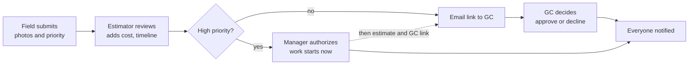
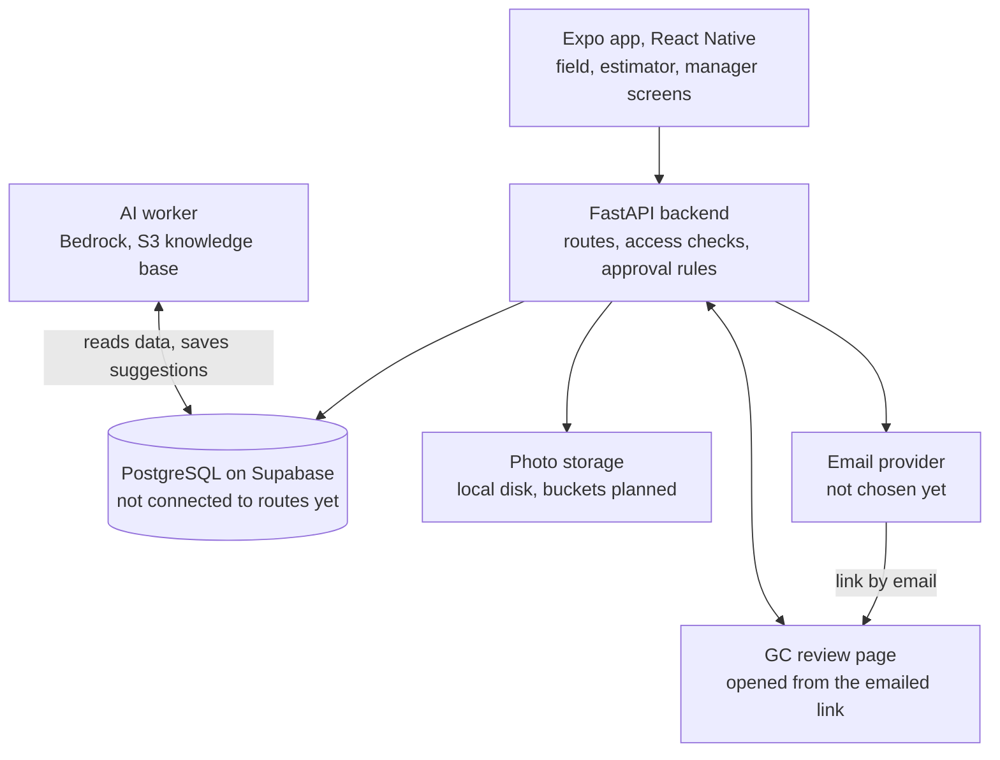
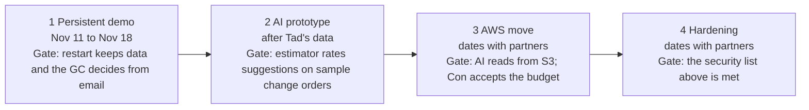

# Change Order: Specification v0.2

**Date:** November 11, 2026
**Status:** Proposed update to [SPECIFICATIONS.MD](SPECIFICATIONS.MD) (v0.1, Oct 9). Not yet reviewed by the team or the partners.

## Summary and what changed

Version 0.2 folds in the Nov 4 workflow meeting and the Nov 5 data meeting, and it records what the code does today. Where sources conflict, the conflict is listed under [Open decisions](#open-decisions-and-assumptions) rather than silently resolved. v0.1 stays in the repository as the original design.

The product is unchanged: a field worker photographs a change, the estimator prices it, and a general contractor approves it from an emailed link. What moved is who the people are called, that AI cost estimation is now central, and how approval works for urgent changes.

| Topic | v0.1 (Oct 9) | v0.2 | Source |
| --- | --- | --- | --- |
| Personas | Contractor, office reviewer, client | Field, estimator, manager, GC | Nov 4 meeting |
| Pricing | Out of scope for the MVP | Estimator enters cost; AI suggests a scope check and estimate | Nov 4 meeting |
| Urgent changes | No automatic approval | High priority: manager authorizes work now; estimate and GC approval follow | Oct 20 and Nov 4 meetings |
| Photos | Optional evidence | Multiple photos, context only, not AI input yet | Nov 4 meeting |
| Identity | OIDC provider | Staff sign in with Supabase accounts; GC uses a hashed email token | Oct 20 meeting |
| Storage | Unselected | Supabase buckets now, S3 when AI is added | Oct 20 meeting |
| AI | Advisory scope comparison | AWS Bedrock with an S3-backed knowledge base, trained on partner data | Oct 20, Nov 4, Nov 5 meetings |

## Personas

Four personas replace the three in v0.1. Con asked for industry-standard terms because "client" is vague in software. The GC is also external to the app, so it cannot be a normal user. Each company's records are isolated from every other company's.

| Persona | Replaces | What they do | How they get in |
| --- | --- | --- | --- |
| Field | Contractor | A foreman or on-site subcontractor rep. Photographs the change, describes it, sets priority, sees its status | Mobile app, standard credentials |
| Estimator | Office reviewer | Reviews the change, checks whether it is in scope, writes the description, requested timeline and proposed cost, and sends it to the GC | App, standard credentials |
| Manager | Admin or boss | The estimator's boss. Authorizes high-priority work to start before the estimate | App, standard credentials |
| GC | Client | General contractor. Approves or declines the exact proposal. Cannot be required to use the app | Emailed link with a hashed token, no account |

The field worker should know what to photograph, so the capture screen prompts for it. The database and UI still say contractor, admin and client; renaming is tasks B2 and U1 in the 1-week plan.

## Workflow and approval rules

Priority decides the path. A normal change goes to the GC. A high-priority change is authorized by the manager so work can start now, because contracts increasingly say a change order cannot affect the timeline. The estimate follows, and the GC still approves or declines the cost afterward, so the price is agreed before it is final. This rule was decided on Nov 11 and should be confirmed with Con.

- The estimator completes description, requested timeline and proposed cost before a normal change reaches the GC. On a fast-track change the cost follows the authorization, and the GC link is sent once it is entered.
- GC approval is external. The app cannot require the GC to sign in, so email is the approval path.
- Every status change notifies the people it affects.
- A timeout never approves a change (carried from v0.1).
- Status names disagree: the code uses submitted, awaiting_client, approved, rejected; the Nov 3 schema uses office_review, awaiting_client, approved, declined. Decided: one set, used in the code and the migration (task B2): submitted, in_review, authorized_to_proceed (fast track only), awaiting_gc, approved, declined, withdrawn.

## Architecture and tech stack

One backend sits between the apps and everything else. The apps never talk to the database, storage or AI directly, and only the backend holds provider credentials.

| Layer | Choice | Note |
| --- | --- | --- |
| Front end | React Native with Expo, Tailwind styling | One codebase for iOS and Android; Expo Go on a physical phone avoids Windows emulator limits. Swift was ruled out as iOS only |
| Backend | Python with FastAPI | Built; runs on port 8000 |
| Database | PostgreSQL on Supabase through SQLModel | Schema drafted, not yet wired |
| Photos | Local disk now, Supabase buckets set up, S3 when AI is added | Served publicly today; should become private |
| AI | AWS Bedrock with an S3-backed knowledge base | Later; depends on Tad's data |
| Email | Not chosen | Needed for the GC link |
| Hosting | Not selected | Decide after the AI move to AWS |

The repository uses `backend/`, `frontend/` and `scripts/`, not the directory names in v0.1.

## Data model and storage

PostgreSQL is the system of record, hosted on Supabase for now. The Nov 3 schema on `origin/persistentdb` covers the core flow but is not migrated or connected to the routes. SQLModel's `create_all` does not alter existing tables, so changes need an explicit migration.

| Entity | State | Purpose |
| --- | --- | --- |
| User | Drafted | Person and role (contractor, admin, client today; to become field, estimator, manager, GC) |
| ChangeEvent | Drafted | The field report: description, priority, status, photo key |
| ChangeOrder | Drafted | One proposal per field report |
| ChangeOrderRevision | Drafted | Proposed terms; a sent revision is never edited |
| ApprovalRequest | Drafted | Request to the GC for one revision |
| ApprovalDecision | Drafted | One final decision per request |
| Notification | Drafted | Alert per recipient |
| Company | Proposed | Boundary that isolates each company's change orders |
| Photo | Proposed | Several photos per report, each with a storage key |
| Proposed cost and timeline | Proposed | Fields on the revision; money as integer cents with a currency |
| ApprovalLink | Proposed | Stores only the hash of the GC token, with expiry and revocation |

Photos live in Supabase buckets today and move to S3 when the AI layer is added. The running backend still saves photos to local disk and serves them publicly at `/uploads`; that is a prototype shortcut and conflicts with private evidence storage.

## AI cost estimation

The AI worker reads existing change-order data and suggests two things: whether a reported change is in scope, and what it might cost. It is advisory. The estimator makes the final call, because Con pointed out that estimate accuracy decides whether subcontractors get paid. Photos are context for people and are not AI inputs at this stage.

**Design.** The model comes from AWS Bedrock's catalog, connected to a knowledge base backed by S3 and trained on Tad's data plus public datasets. Whether that means retrieval over a knowledge base, fine-tuning, or both is not settled (see open decisions). The scope check follows Tad's rule: anything absent from the original proposal is flagged as a likely change order, so original proposals are the scope baseline.

**Cost.** The Nov 4 notes quote about $0.02 per 1M input tokens and about $10 per 10M output tokens. Those figures need checking against current Bedrock pricing for the chosen model. Bona owes Con a token budget and model choice (task B4).

**Data from Tad (Zack Smith Plumbing).** An NDA is signed. The Nov 5 request, in two tiers:

| Tier | What | Purpose |
| --- | --- | --- |
| Minimum | A handful of original proposals with their change orders: request, final proposal, revisions, approval, final amounts, dates | Proof of concept |
| Full | Many more of the same, plus cost breakdowns: labor hours and rates by trade, materials, equipment, subcontractor quotes, permits, overhead, markup, tax | Accurate estimates |

Open on Tad's side: bid sheets may be proprietary, so he will try a redacted breakout of labor rates and expenses. Daily field reports are plentiful but not redacted, so only those tied to change orders will be shared. Supplier quotes are easy to provide. The outline is sent; his estimator was out when we met, so timing is unknown.

Each suggestion is stored with its model version, a reason, and a confidence, and never approves anything.

## Notifications and GC approval

Every party is notified at each stage, and the GC reviews through an emailed link. Today notifications are stored in memory and nothing is sent; the table shows the target behavior.

| Event | Recipient | How |
| --- | --- | --- |
| Change submitted | Estimator (and manager if high priority) | In-app alert |
| Proposal sent | GC | Templated email with a review link |
| GC approves or declines | Field, estimator, manager | In-app alert |
| Manager authorizes a fast-track change | Field, GC | In-app alert, plus a heads-up email to the GC; wording to be agreed |

Push notifications from v0.1 stay a later increment, because they need a development build rather than Expo Go.

The GC link works without an account:

- The token is long, random, shown once, and only its hash is stored.
- It is bound to one change order and one proposal revision; a new revision invalidates the old link.
- Opening the link or a mail scanner fetching it must never approve or decline. Only an explicit button press decides.
- Expiry and revocation are required before real use. The current prototype has neither.

The Oct 20 notes say bcrypt; the code uses SHA-256 on a random 32-byte token. SHA-256 is adequate for random tokens, and bcrypt matters for human-chosen passwords. Staff passwords, once accounts exist, should use bcrypt or the auth provider's hashing.

## API and security

The routes below are what `main` implements today, followed by what v0.2 adds. All sit under `/api/v1` except `/health`.

| Route | State | Purpose |
| --- | --- | --- |
| `POST /changes` | Built | Multipart: description, priority, one photo |
| `GET /changes?status=` | Built | List changes, optionally by status |
| `POST /changes/{id}/admin-approve` | Built | Office review; high priority approves, normal sends to the GC |
| `GET /approval-session?token=` | Built | GC views the change |
| `POST /approval-session/approve` and `/decline` | Built | GC decision |
| `GET /notifications?to=` | Built | Stored alerts |
| `POST /changes` with several photos | Planned | Multiple photos per report |
| Estimator review route | Planned | Save cost, requested timeline and notes |
| Manager authorize route | Planned | Authorize work on a high-priority change before the estimate |
| Persisted storage for all of the above | Planned | Replace the in-memory store |

Security requirements for v0.2:

- **Tenant isolation.** Every record carries a company, and every query filters by it. This is the "hash token isolates each company" idea from Nov 4, made explicit.
- **Private evidence.** Photos should be served through checked access, not a public folder.
- **Roles on the server.** The server derives who the caller is; it never trusts a role or company sent by the app.
- **Tokens.** Hashed, expiring, revocable, scoped to one proposal; the token currently travels in the URL query, which is acceptable for a link but should be exchanged for a short session on open.
- **Safe retries.** Submit and decision routes should accept an idempotency key so a retry never creates a second record or decision (carried from v0.1).

## Team ownership and roadmap

Roles were confirmed by the team on Nov 11. The day-by-day tasks live in the 1-week plan.

| Person | Role | Owns |
| --- | --- | --- |
| Bona | Project coordinator, database lead, AI lead | Schema and migrations, repository layer, AI integration, Tad's data, partner contact |
| Jalen | Backend API lead | Photo upload, estimator review, GC email, routes on the database, backend tests |
| Uriel | Frontend lead, architecture and specification | Expo screens, GC page, demo, this document |

Each task has one owner and one reviewer. Phase 1 is this week's demo. Later phases are ordered by dependency, not dated, because they wait on Tad's data and the partners' feedback.

## Open decisions and assumptions

The first two rows contradict or leave gaps in the meeting notes and need an answer from the partners before building them.

| Decision | Why it matters | Proposed default |
| --- | --- | --- |
| Does a high-priority change skip GC consent, or only the full estimate? Oct 20 says it bypasses the client; Nov 4 says approval without a full estimate | Changes who can authorize work and what the GC sees | Decided Nov 11: the manager authorizes work now, the estimate follows, and the GC still approves the cost. Confirm with Con at the partner meeting |
| Who is "Zach Smith" in the Nov 4 flow ("approval back to Zach Smith")? | May be the manager persona or the company | Nobody on the team knows. Bona asks Tad; treated as the manager until answered |
| Email provider and sender address | The GC link cannot go out without it | Decided Nov 11: Bona sets up a free-tier service under the club address; console link until it works |
| Staff sign-in: credentials through Supabase or an OIDC provider | v0.1 chose OIDC; the Oct 20 notes chose credentials | Decided Nov 11: Supabase sign-in, in scope for the Nov 18 demo |
| Token expiry and a one-time code for the GC | Stronger proof than possession of a link | Expiry now, one-time code later |
| Knowledge base, fine-tuning, or both for the AI | Drives data volume, cost and timeline | Start with a knowledge base over Tad's proposals and change orders |
| Hosting for the API | Unselected | Decide after the AI move to S3 and Bedrock |
| Spelling of the partner: Zack or Zach Smith | Documents and the partner-facing demo | Ask Tad |

Assumptions carried from v0.1: one designated GC approver per change order, one change order per field report, original scope entered before a report, and the server as the source of truth. Timeouts never approve anything. Offline photo upload is useful but deferred until the core flow works. Billing, payroll and multi-approver contracts remain out of scope.
