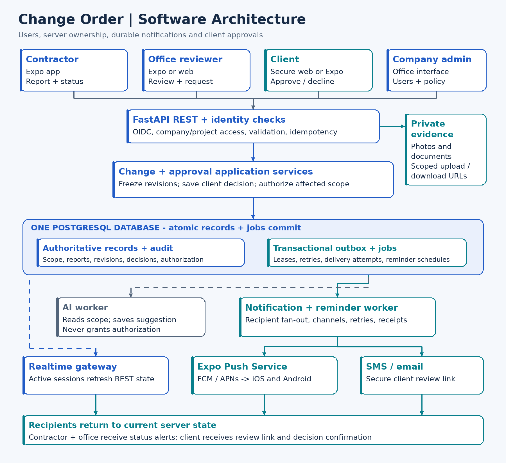
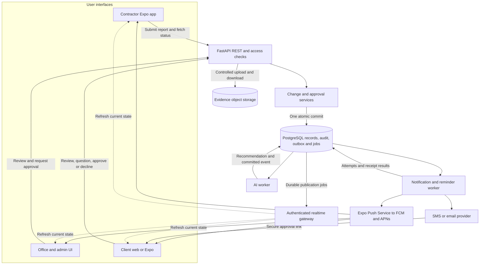
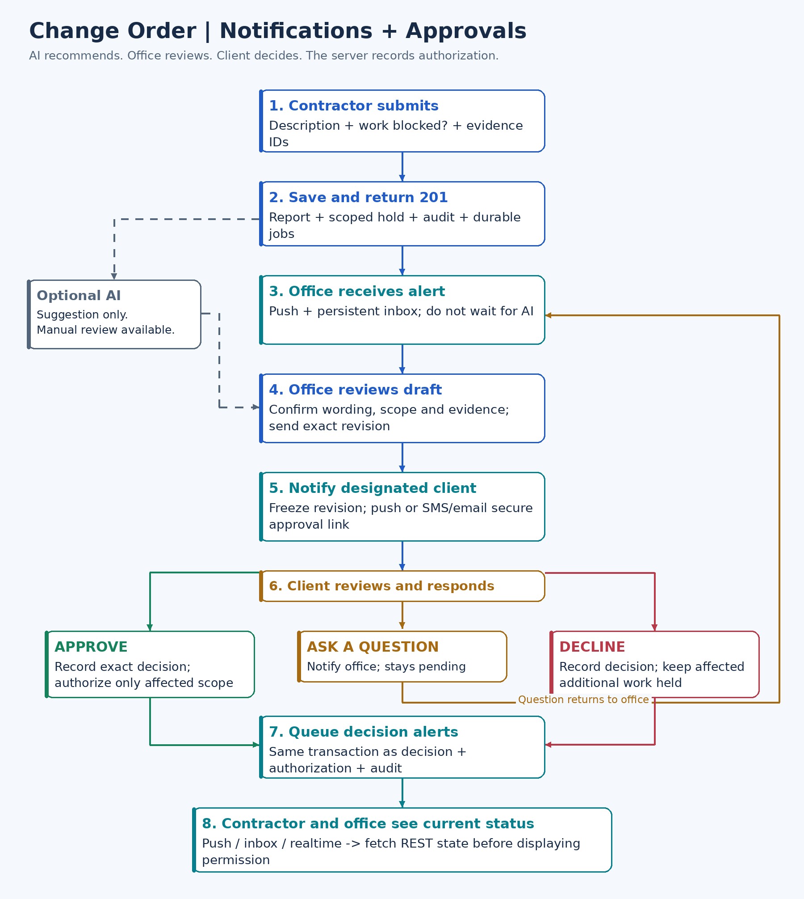
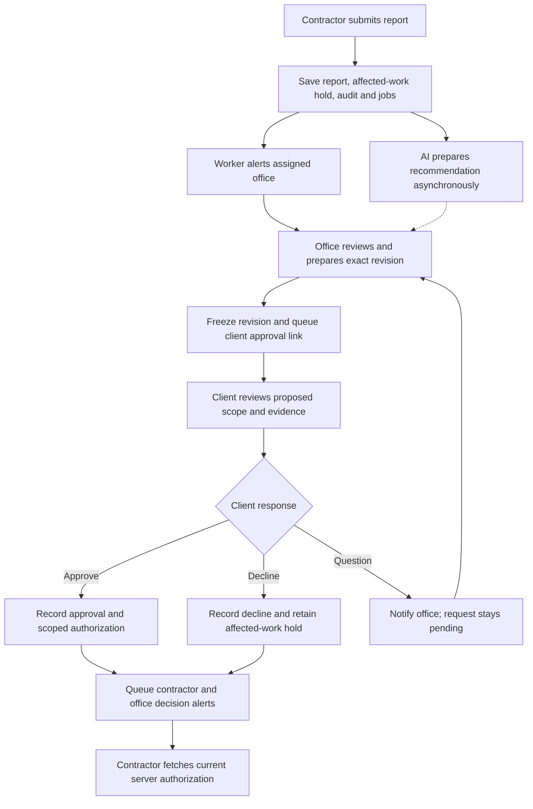
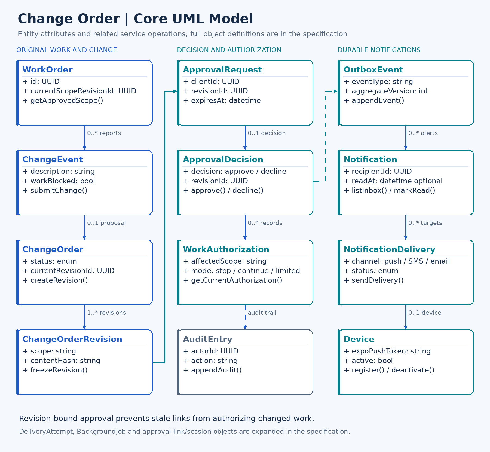
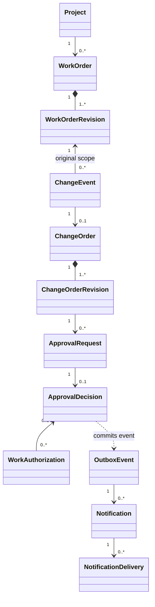

# Change Order

# Software Design Specification

**Version:** 0.1 - proposed MVP design  
**Date:** October 9, 2026  
**Status:** Design draft; implementation and hosting are not yet verified

### Team Members

- Aadi Bery (sdsuaiclub@gmail.com)
- Jaylan Luong (jluong5067@sdsu.edu)
- Uriel Zacarias (urielzacarias@gmail.com)
- Tad Schiller (tad@zacksmithplumbing.com)
- Ajay (arao3465@sdsu.edu)
- Bona O'Quinn (boquinn1053@sdsu.edu)

## 1. System Description

### 1.1 Purpose

This specification defines the architecture, users, data, interfaces, and behavior of an application that helps field contractors report changes to approved work and obtain a documented client decision quickly. It is intended for developers, project reviewers, and the project team.

### 1.2 Scope

The first complete workflow is: contractor submits a change, office receives an alert, office reviews and prepares the change order, client approves or declines the exact proposed revision, and contractor receives updated authorization for the affected work. Clients may use a secure web link without installing the mobile app. AI can compare field evidence with original scope and prepare a draft; human review and authorization remain required.

The MVP includes user access, assigned work orders, text/photo reports, manual drafting, approval links, notifications, a persistent inbox, audit history, and delivery retries. AI, realtime hints, and configurable reminders are added after the basic approval path works. Automated pricing, billing, payroll, multi-approver contracts, and emergency authorization are outside the first MVP. Office-entered amounts may be enabled later without adding an AI pricing engine.

### 1.3 Design basis

The design continues the agreed Expo/React Native frontend, FastAPI backend, and PostgreSQL database. The supplied AWS.png is an alert-validation/reporting workflow and UML-PROJECT1.png is a class model for the park project; their separation of reporting, human classification, and record keeping informs this design. They do not establish AWS as this project's hosting provider.

The user supplied the complete Mountain Lion Detection System Software Design Specification as Pasted text.txt after the GitHub link could not be accessed. This document follows its main sections: System Description, Software Architecture Overview, UML class descriptions, Development of Plan and Timeline, Tasking Partition, and Timeline. API, security, data, and verification details extend that template for this project.

### 1.4 Terms

| Term             | Meaning                                                                 |
| ---------------- | ----------------------------------------------------------------------- |
| Work order       | Existing approved work and its preserved scope revision                 |
| Change event     | Contractor's report of an unexpected condition or proposed scope change |
| Change order     | Office-prepared proposal derived from a change event                    |
| Revision         | Version of proposed terms; frozen when sent for approval                |
| Approval request | Request directed to the project's designated client for one revision    |
| Authorization    | Server-recorded permission for a specifically identified scope of work  |
| Outbox           | Database records of committed events awaiting asynchronous processing   |
| Push receipt     | Provider handoff result; it does not prove the person read the alert    |

## 2. Software Architecture Overview

### 2.1 Users and access

| User                  | Main responsibilities                                                                     | Main interface                     | Authorization boundary                                                    |
| --------------------- | ----------------------------------------------------------------------------------------- | ---------------------------------- | ------------------------------------------------------------------------- |
| Contractor            | View assigned work; report conditions; add evidence; read current authorization           | Expo mobile app                    | Assigned projects and work orders; cannot approve as client               |
| Office reviewer       | Review reports and AI suggestions; draft/revise terms; request approval; answer questions | Expo or responsive office UI       | Assigned projects; cannot impersonate a client decision                   |
| Client                | Review exact proposed terms; ask questions; approve or decline                            | Secure web page; optional Expo app | Own designated approval requests and allowed evidence                     |
| Company administrator | Manage memberships, assignments, notification settings, and unresolved delivery failures  | Office administration UI           | Own company; administration alone does not grant client signing authority |

Users authenticate through an OIDC provider. Local CompanyMembership records define company roles; ProjectAssignment records define project responsibility. A client may have an authenticated account or use a request-scoped link session. All staff operations enforce company and project access on the server. Assigned office staff receive new-report alerts; the reporting contractor and assigned office receive decision alerts.

### 2.2.1 Architecture style

Use a modular monolith: one backend codebase with independently running API and worker processes. Keep mobile, client web, and backend directories separate. The mobile application does not connect to PostgreSQL or call AI/push providers with backend credentials.

### 2.2.2 Component boundaries

| Component           | Owns                                                                                   | Does not own                                             |
| ------------------- | -------------------------------------------------------------------------------------- | -------------------------------------------------------- |
| Expo client         | Screens, camera/library access, notification permission/token, local draft, REST calls | Approval rules, provider secrets, authoritative workflow |
| Client web          | Focused revision review and explicit decision controls                                 | Internal office notes, arbitrary project access          |
| FastAPI services    | Identity mapping, permission checks, transitions, revisions, decisions, authorization  | Slow provider delivery inside a mutation transaction     |
| AI worker           | Scope comparison and suggested wording                                                 | Client decisions or permission to perform work           |
| Notification worker | Recipient fan-out, channel selection, delivery, retries, receipts                      | Changing contractual decisions based on delivery status  |
| PostgreSQL          | Authoritative records, audit, idempotency, durable jobs                                | Evidence file bytes                                      |
| Object storage      | Private evidence bytes                                                                 | User access policy; API grants scoped URLs               |

### 2.2.3 Transport responsibilities

REST carries commands and authoritative reads. WebSocket messages are change hints for active users. Push attracts background users' attention. SMS/email carries the secure review link when a client does not have the app. All channels resolve back to server state before showing current authorization.

### 2.3 Notifications and approvals

### 2.3.1 Submission transaction

Validate the actor and work order, attachment readiness, and idempotency key. In one transaction create ChangeEvent, initial scoped WorkAuthorization, AuditEntry, OutboxEvent, and required BackgroundJobs. Commit and return HTTP 201. The office alert must not wait for AI analysis. A failed AI job leaves manual office review available.

### 2.3.2 Office review and request transaction

Office verifies scope, wording, evidence, and schedule impact. Sending freezes a ChangeOrderRevision and creates a designated ApprovalRequest, hashed ApprovalLink, audit records, and notification jobs. Editing proposed terms creates a new revision and cancels superseded pending requests. The old link cannot approve the new content.

### 2.3.3 Client decision transaction

Lock the current order and request. Verify client authority, request status/expiry, exact revision, and idempotency. Save one ApprovalDecision, update the order, append WorkAuthorization and AuditEntry, cancel reminder schedules, and insert notification/realtime jobs atomically. Return the committed decision without waiting for provider delivery. Approval releases only the proposed affected scope; a decline preserves its hold. Original approved work follows its own authorization.

### 2.3.4 Questions and revisions

A question is a client-visible Comment and an office alert; it is not a decline and does not release the hold. If an answer changes the terms, office issues a new revision and new approval request. If wording and terms are unchanged, the existing pending request remains available.

### 2.3.5 Recipient/channel matrix

| Event                          | Recipient                              | Channel                                          | Destination                  |
| ------------------------------ | -------------------------------------- | ------------------------------------------------ | ---------------------------- |
| change.submitted               | Assigned office                        | Push + inbox                                     | Change review                |
| change.analysis_completed      | Assigned office                        | Inbox/realtime; usually no second push           | Change review                |
| approval.requested             | Designated client                      | Push if registered; otherwise verified SMS/email | Exact revision review        |
| approval.question_created      | Assigned office                        | Push + inbox                                     | Client-visible discussion    |
| approval.approved              | Reporting contractor + assigned office | Push + inbox + realtime                          | Current scoped authorization |
| approval.declined              | Reporting contractor + assigned office | Push + inbox + realtime                          | Hold and decision reason     |
| approval.reminder_due          | Client or escalation recipient         | Configured channel                               | Pending approval             |
| notification.permanent_failure | Office/admin                           | Operational inbox                                | Delivery failure review      |

An in-app inbox entry is retained even if push permission is denied or no device is registered. A reminder never grants automatic approval. Proposed configurable delays are 15 minutes for a client reminder, 30 for office escalation, and 60 for a designated project manager. They require company configuration and are not hardcoded contractual deadlines.

### 2.4 UML

The model replaces the reference project's sensors/ranger classification with contractor reports, office review, and explicit client decisions. Domain entities retain records; application services perform authorized mutations. There is no User.password field in this model because credentials are handled by the selected identity provider.

### 2.5 UML class descriptions

Each entry identifies its purpose, attributes, and related service functions, following the reference specification's class-description pattern. Shared identifiers, companyId, timestamps, and access checks apply even when not repeated. Functions describe service operations over the object rather than requiring mutable ORM methods.

| Class                                  | Purpose                                                   | Key attributes                                                                                  | Functions / service operations                                            |
| -------------------------------------- | --------------------------------------------------------- | ----------------------------------------------------------------------------------------------- | ------------------------------------------------------------------------- |
| Company                                | Boundary for a contractor business                        | id: UUID; name: string; approvalPolicy: configuration                                           | getCompany(); configurePolicy() - admin only                              |
| User / CompanyMembership               | Verified identity and company role                        | userId: UUID; authSubject: string; role: enum; active: bool                                     | getCurrentUser(); requireMembership(); deactivateMembership()             |
| Client                                 | Designated customer identity and verified contact         | id: UUID; companyId: UUID; userId: optional UUID; contact: string                               | getClient(); verifyContact(); requireClientAuthority()                    |
| Project / ProjectAssignment            | Project scope and staff responsibilities                  | projectId: UUID; clientId: UUID; membershipId: UUID; responsibility: enum                       | listAssigned(); assignMember(); getRecipients()                           |
| WorkOrder / WorkOrderRevision          | Original approved scope and preserved versions            | id: UUID; number: string; projectId: UUID; revisionId: UUID; scopeHash: string                  | getApprovedScope(); getRevision(); listWorkOrders()                       |
| ChangeEvent                            | Contractor's report of a possible change                  | id: UUID; scopeRevisionId: UUID; description: string; workBlocked: bool; status: enum           | submitChange(); getChange(); createDraft()                                |
| Attachment / EvidenceLink              | Private ready evidence associated with the report         | id: UUID; objectKey: string; checksum: string; status: enum; changeEventId: UUID                | createUpload(); finalize(); getDownload(); attachEvidence()               |
| AIAnalysis                             | Advisory comparison with original scope                   | reason: string; proposedScope: string; modelVersion: string; confidence: decimal                | analyzeScope(); saveRecommendation() - no approval authority              |
| ChangeOrder / ChangeOrderRevision      | Office-prepared proposal and frozen client terms          | id: UUID; revisionNumber: int; scope: string; contentHash: string; frozenAt: datetime           | createRevision(); freezeRevision(); sendForApproval()                     |
| ApprovalRequest / ApprovalLink         | Revision-bound request and limited review access          | revisionId: UUID; clientId: UUID; status: enum; expiresAt: datetime; tokenHash: string          | createRequest(); exchangeLink(); revokeLink(); reissueRequest()           |
| ApprovalDecision                       | Client's explicit final answer for one revision           | requestId: UUID; revisionId: UUID; decision: enum; decidedAt: datetime; method: string          | approve(); decline(); getDecision() - designated client only              |
| WorkAuthorization                      | Permission or hold for the affected work                  | mode: stop/continue/limited; affectedScope: string; decisionId: optional UUID                   | getCurrentAuthorization(); appendAuthorization() - backend only           |
| Comment                                | Internal or client-visible discussion                     | authorIdentity: UUID; body: string; visibility: enum; changeEventId: UUID                       | listComments(); createComment(); askQuestion()                            |
| Notification / Device                  | Persistent recipient alert and registered installations   | notificationId: UUID; recipient: UUID; routeData: JSON; token: string; active: bool             | listInbox(); markRead(); registerDevice(); deactivateDevice()             |
| NotificationDelivery / DeliveryAttempt | Per-channel target, attempts, tickets and receipt results | channel: enum; status: enum; attemptNumber: int; ticketId: string; errorCode: string            | sendDelivery(); checkReceipts(); retryOrFail()                            |
| OutboxEvent / BackgroundJob            | Durable asynchronous processing after a command commits   | eventType: string; payload: JSON; consumer: string; availableAt: datetime; leaseUntil: datetime | appendEvent(); claimJob(); acknowledgeJob(); recoverLease()               |
| EscalationSchedule                     | Reminder timing for pending approval requests             | requestId: UUID; step: enum; dueAt: datetime; status: enum                                      | scheduleReminder(); revalidatePending(); cancelSchedules()                |
| AuditEntry / IdempotencyRecord         | Historical accountability and safe command retries        | actor: UUID; action: string; correlationId: string; key: string; requestHash: string            | appendAudit(); listAudit(); getStoredResponse(); rejectConflictingRetry() |

Section 7 expands the persistent data relationships and integrity rules; Section 9 maps operations to the actual HTTP routes.

## 3. Development of Plan and Timeline

Development is divided into separate frontend and backend workstreams, joined through documented API contracts and an end-to-end acceptance workflow. Roles identify who tracks a task through completion; contributors may work across roles according to experience. Frontend and backend should integrate early using fake notification/AI adapters rather than waiting until every component is complete.

The first milestone is a notification round trip: sign in, register a device, queue a self-test, process it through the worker, and receive/open it on a development-build phone. The next milestone is one report through office review and client decision, including scoped authorization and contractor alerts. Evidence, AI, realtime and escalation follow that working path.

Progress is tracked with small reviewable tasks, service/API contracts, integration checks, and a shared issue board. Completion means the acceptance behavior works across frontend and backend, not merely that a screen or endpoint exists.

## 4. Tasking Partition

Team members from the reference park project are not automatically assigned to Change Order. The responsibilities below are proposed; Uriel's architecture role is carried forward as a proposal, and remaining ownership is confirmed when collaborators join.

| Role                           | Proposed ownership        | Responsibilities                                                                    |
| ------------------------------ | ------------------------- | ----------------------------------------------------------------------------------- |
| Project manager                | Assign during kickoff     | Scope, priorities, dependencies, progress, milestone acceptance                     |
| Systems architecture developer | Uriel Zacarias - proposed | Boundaries, data model, API contracts, workflow rules, deployment design            |
| Backend developer              | Assign during kickoff     | FastAPI, migrations, access checks, approvals, outbox, provider adapters            |
| Frontend developer             | Assign during kickoff     | Expo reporting/status, office review, client approval page, notification navigation |
| Test developer                 | Assign during kickoff     | Tenant/permission tests, decision races, retries, physical-device workflow          |

One person may hold multiple roles in a small team. Provider accounts, production access, and client data should be available only to the people who need them.

## 5. Timeline

This is a proposed six-week sequence beginning at project kickoff, not an agreed calendar deadline. Adjust it for team size, school commitments and integration findings.

| Week | Frontend work                                            | Backend / architecture work                                           | Exit condition                                               |
| ---- | -------------------------------------------------------- | --------------------------------------------------------------------- | ------------------------------------------------------------ |
| 1    | Screen flow and notification development build           | Confirm access rules, schema, local stack and provider choices        | Reviewed architecture and API contracts                      |
| 2    | Sign-in, token registration, inbox and notification taps | Devices, outbox/jobs, Expo adapter, self-test and receipt handling    | Real phone receives/open self-test; restart-safe queue       |
| 3    | Work order, report form, status and office queue         | Scope revisions, idempotent report, office alert, manual draft        | Contractor report reaches office without AI dependency       |
| 4    | Client review, questions and decision screen             | Frozen revisions, secure sessions, decision/authorization transaction | Full manual approval path and stale-link/race checks         |
| 5    | Photo capture/upload; optional live status               | Private evidence, optional AI fallback, realtime and reminders        | Evidence path works; optional features do not block approval |
| 6    | Usability/accessibility and device testing               | Failure tests, monitoring, deployment/backup review, pilot metrics    | Pilot-ready workflow passes acceptance checks                |

If time is limited, stop feature expansion after Week 4 and validate the complete manual path before adding AI or reminders.

## 6. Requirements

| ID    | Functional requirement                                               | Acceptance condition                                                   |
| ----- | -------------------------------------------------------------------- | ---------------------------------------------------------------------- |
| FR-01 | Authenticate users and enforce company/project access                | Cross-company reads and mutations are denied                           |
| FR-02 | Show assigned work orders and preserved original scope               | Contractor sees only assigned work                                     |
| FR-03 | Submit a description, blockage indicator and optional ready evidence | Submission creates one durable report                                  |
| FR-04 | Notify office independently of AI                                    | Office job exists in report commit                                     |
| FR-05 | Produce an optional AI scope recommendation                          | Failure does not block manual review                                   |
| FR-06 | Allow office to draft and revise a change order                      | Sent/approved historical terms cannot be overwritten                   |
| FR-07 | Request approval for one frozen revision                             | Request and link bind to that revision and client                      |
| FR-08 | Support explicit client approval, decline and questions              | One final decision per request; question remains pending               |
| FR-09 | Record authorization for the affected scope                          | Mobile displays the current server record                              |
| FR-10 | Alert contractor and office after a decision                         | Alerts are queued in the decision transaction                          |
| FR-11 | Register multiple devices and retain inbox history                   | Token ownership follows authenticated device registration              |
| FR-12 | Retry delivery and examine provider receipts                         | Invalid devices are disabled; failure remains visible                  |
| FR-13 | Record actor, revision and timestamp for critical changes            | Audit history survives retries and worker restart                      |
| FR-14 | Provide controlled reminders and live status hints                   | Terminal requests suppress unsent reminders; reconnect refetches state |

FR-05 and the realtime/reminder portions of FR-14 are follow-on increments. The first notification/approval slice implements the remaining core behaviors without depending on AI.

## 7. Data design

### 7.1 Persistent objects

| Area             | Objects and key fields                                                                                                                                                                                                                                  |
| ---------------- | ------------------------------------------------------------------------------------------------------------------------------------------------------------------------------------------------------------------------------------------------------- |
| Identity         | Company(id, name, policy); User(id, authSubject); CompanyMembership(companyId, userId, role, active)                                                                                                                                                    |
| Assignment       | Client(id, companyId, optionalUserId, verifiedContact); Project(id, clientId); ProjectAssignment(projectId, membershipId, responsibility)                                                                                                               |
| Original scope   | WorkOrder(id, number, projectId, currentRevisionId); WorkOrderRevision(id, revisionNumber, scopeHash); WorkOrderItem(revisionId, description, quantity, unit)                                                                                           |
| Reporting        | ChangeEvent(id, workOrderRevisionId, reportedBy, description, workBlocked, version, status); Attachment(id, objectKey, checksum, status); EvidenceLink(changeEventId, attachmentId)                                                                     |
| AI               | AIAnalysis(changeEventId, scopeRevisionId, reportHash, modelVersion, reason, proposedScope, confidence)                                                                                                                                                 |
| Proposal         | ChangeOrder(id, changeEventId, currentRevisionId, status); ChangeOrderRevision(id, title, reason, scope, scheduleImpact, evidenceIds, contentHash, frozenAt); optional ChangeOrderItem                                                                  |
| Approval         | ApprovalRequest(id, revisionId, clientId, status, requestedAt, dueAt, expiresAt, viewedAt); ApprovalLink(requestId, tokenHash, expiry, revokedAt); ApprovalDecision(requestId, revisionId, clientId, decision, method, decidedAt)                       |
| Authorization    | WorkAuthorization(changeEventId, approvedRevisionId, decisionId, mode, affectedScope, reason, effectiveAt)                                                                                                                                              |
| Discussion/audit | Comment(changeEventId, authorIdentity, body, visibility); AuditEntry(actor, action, entity, correlationId, occurredAt, changeSummary)                                                                                                                   |
| Delivery         | Device(userId, installationId, token, platform, active); Notification(eventId, recipient, type, routeData, readAt); NotificationDelivery(notificationId, target, channel, status); DeliveryAttempt(deliveryId, number, ticketId, providerStatus, error) |
| Background       | OutboxEvent(type, aggregateId, version, payload); BackgroundJob(eventId, consumer, status, availableAt, leaseUntil, attempts); EscalationSchedule(requestId, step, dueAt, status)                                                                       |
| Deduplication    | IdempotencyRecord(actorScope, route, key, requestHash, storedResponse, expiresAt)                                                                                                                                                                       |

Every tenant-owned record includes companyId and timestamps even when omitted from the compact table. Use UUID identifiers, separate human-readable numbers, UTC timestamps, and immutable scope/revision snapshots. Optional monetary fields use integer minor units plus currency; they are not required for the initial no-pricing MVP.

### 7.2 Core associations

### 7.3 Integrity and indexes

Enforce unique approval decisions per request and at most one pending designated-client request per current revision. Enforce one change order per change event for this MVP. Use company-aware foreign-key validation, not only a companyId column. Notifications are unique per source event, recipient, and type; jobs are unique per event and consumer; deliveries are unique per notification/channel/target. Device installation and active token ownership must not leave an old account registered after account switching.

Index assigned project/work-order lookups, pending approval requests, recipient inbox cursors, runnable job status/availableAt, expiring leases, pending receipt checks, and audit entity/time queries. Application roles can append audit records but cannot update/delete them. Backup and database access policy enforce preservation; the table name alone does not make records immutable.

## 8. Component design and methods

| Module              | Public service functions                                            | Dependencies                                               |
| ------------------- | ------------------------------------------------------------------- | ---------------------------------------------------------- |
| Identity/access     | getCurrentUser(), requireMembership(), requireProjectAccess()       | OIDC validation, memberships, assignments                  |
| Work orders         | listAssigned(), getApprovedScope()                                  | Scope revision repository                                  |
| Changes             | submitChange(), getChange(), createDraft(), sendForApproval()       | Authorization, audit, outbox, evidence                     |
| Revisions           | createRevision(), freezeRevision(), cancelSupersededRequests()      | Order/request repositories                                 |
| Approvals           | exchangeLink(), getReview(), approve(), decline(), askQuestion()    | Client scope, revision locks, authorization, audit, outbox |
| Devices             | register(), deactivate()                                            | Authenticated device ownership                             |
| Notifications       | createRecipientAlerts(), queueDeliveries(), listInbox(), markRead() | Assignments, client contacts, device repository            |
| Notification worker | claimJobs(), sendDelivery(), checkReceipts(), retryOrFail()         | Expo/SMS/email adapters, job leases                        |
| AI worker           | analyzeScope(), saveRecommendation()                                | Frozen scope/report/evidence, AI adapter                   |
| Realtime            | authorizeSubscription(), publishCommittedEvent()                    | Tenant/project access, durable publication jobs            |

Routes validate HTTP inputs and delegate to services. Services own transaction boundaries; repositories persist records. Providers implement adapters so Expo, SMS/email, and AI integrations can be tested with fakes and replaced without changing mobile screens.

## 9. External interface and API design

### 9.1 Routes

Prefix REST routes with /api/v1. Office, contractor, and client labels below also require the correct company/project/request relationship.

| Method and route                     | Function                          | Authorized caller                           |
| ------------------------------------ | --------------------------------- | ------------------------------------------- |
| GET /me                              | IdentityService.getCurrentUser    | Signed-in user                              |
| POST /devices                        | DeviceService.register            | Signed-in device owner                      |
| DELETE /devices/{id}                 | DeviceService.deactivate          | Device owner                                |
| GET /work-orders                     | WorkOrderService.listAssigned     | Assigned staff                              |
| GET /work-orders/{id}                | WorkOrderService.getApprovedScope | Assigned staff                              |
| POST /attachments/uploads            | AttachmentService.createUpload    | Assigned contractor/office                  |
| POST /attachments/{id}/complete      | AttachmentService.finalize        | Authorized uploader                         |
| GET /attachments/{id}/download       | AttachmentService.getDownload     | Authorized evidence viewer                  |
| POST /work-orders/{id}/changes       | ChangeService.submitChange        | Assigned contractor/office                  |
| GET /changes/{id}                    | ChangeService.getChange           | Assigned staff                              |
| POST /changes/{id}/change-order      | ChangeService.createDraft         | Assigned office                             |
| POST /change-orders/{id}/revisions   | RevisionService.createRevision    | Assigned office                             |
| POST /changes/{id}/send-for-approval | ChangeService.sendForApproval     | Assigned office                             |
| GET /change-orders/{id}              | ApprovalService.getReview         | Assigned staff/designated client            |
| POST /change-orders/{id}/approve     | ApprovalService.approve           | Designated authenticated client             |
| POST /change-orders/{id}/decline     | ApprovalService.decline           | Designated authenticated client             |
| GET /changes/{id}/comments           | CommentService.list               | Authorized participant; visibility filtered |
| POST /changes/{id}/comments          | CommentService.create             | Authorized participant                      |
| GET /changes/{id}/audit              | AuditService.list                 | Assigned office/admin                       |
| GET /notifications                   | NotificationService.listInbox     | Inbox recipient                             |
| POST /notifications/{id}/read        | NotificationService.markRead      | Inbox recipient                             |
| POST /notifications/test             | NotificationService.queueSelfTest | Signed-in caller; own devices only          |

The client web portal uses a separate restricted session facade over the same ApprovalService:

| Method and route                 | Function                     | Scope                                                   |
| -------------------------------- | ---------------------------- | ------------------------------------------------------- |
| POST /approval-links/exchange    | ApprovalService.exchangeLink | Valid unexpired token                                   |
| GET /approval-session            | ApprovalService.getReview    | One approval request                                    |
| POST /approval-session/approve   | ApprovalService.approve      | One approval request                                    |
| POST /approval-session/decline   | ApprovalService.decline      | One approval request                                    |
| POST /approval-session/questions | ApprovalService.askQuestion  | Client-visible discussion for that request              |
| WS /realtime                     | RealtimeGateway.subscribe    | Authenticated, authorized project/request subscriptions |

### 9.2 Command and error contracts

Report submission, send-for-approval, and decisions require Idempotency-Key. Save the caller/route/key, request hash, and stored result atomically with the command. A repeat with the same body returns the original result; a changed body under the same key returns 409. Submission returns 201; notification self-test returns 202; decisions return 200 after commit. Use 401 for missing/invalid identity, 403 or consistently concealed 404 for inaccessible records, 409 for stale revision/conflicting decision, 410 for expired/revoked approval access, and 422 for invalid input.

Report input contains description, workBlocked, and attachmentIds. Decisions contain approvalRequestId and revisionId; the server derives the client identity and approved terms. Never trust companyId, approvedBy, authorization, or role from client input.

### 9.3 Notification payload and navigation

Push/realtime payloads include eventId, notificationId, type, changeEventId, changeOrderId, approvalRequestId, revisionId, and aggregateVersion as applicable. They do not include signing secrets. The app validates the event type and identifiers, waits for authentication/navigation readiness, and routes to a known screen. The destination fetches current REST state. Handle cold-start taps, token rotation, foreground notifications, and reconnect/resume refresh.

## 10. User interface design

| Screen             | Main content                                                         | Primary action                        |
| ------------------ | -------------------------------------------------------------------- | ------------------------------------- |
| Contractor jobs    | Assigned jobs and active work orders                                 | Open work order                       |
| Work order         | Approved scope, tasks, current changes                               | Report work order change              |
| Report change      | Description, photo capture, work-blocked choice                      | Send change                           |
| Change status      | Server progress, affected scope, authorization, evidence, discussion | Read/respond to requested information |
| Office queue       | Blocked reports first; age and pending decisions                     | Review change                         |
| Office review      | Original scope beside reported condition; optional AI suggestion     | Prepare revision / send for approval  |
| Client review      | Exact proposed work, reason, evidence, schedule, optional amount     | Approve / ask question / decline      |
| Notification inbox | Alerts, read state, deep links                                       | Open current record                   |
| Administration     | Memberships, assignments, policy, delivery failures                  | Configure or resolve                  |

The field report should be quick enough to complete in roughly 30 seconds when evidence is already available; this is a usability target to validate with users. Permission denial does not prevent reporting. Show separate messages for draft saved locally, uploading, submitted, and awaiting review. Do not display submitted before the server commits. Keep local draft retry available; a durable offline queue with background synchronization is a later feature.

Use text/icons with color so hold/approval status is understandable without color perception. Support screen-reader labels, readable touch targets, keyboard navigation on web, explicit confirmation of the exact client terms, and local display of UTC timestamps.

## 11. Workflow states and authorization rules

| Record                 | Allowed states                                                                          |
| ---------------------- | --------------------------------------------------------------------------------------- |
| ChangeEvent            | submitted, analyzing, office_review, needs_information, resolved                        |
| ChangeOrder            | draft, awaiting_client, approved, declined, withdrawn                                   |
| ApprovalRequest        | pending, approved, declined, expired, canceled                                          |
| WorkAuthorization.mode | stop, continue, limited; always scoped to affected work                                 |
| BackgroundJob          | pending, processing, retry_wait, completed, dead_letter                                 |
| Delivery               | pending, retry_wait, ticket_accepted, provider_accepted, unavailable, permanent_failure |

The UI may derive a combined progress label; it must not maintain a second independently mutable approval status. Only the designated client can make a normal final approval decision. Expiry retains the hold. Reissue creates a new request. Revisions and historical decisions remain preserved. There is no automatic approval after a timeout, no AI authorization, and no implication that a decision alert authorizes an entire project.

## 12. Security and privacy design

Validate OIDC issuer, audience, signature, and token expiry. Apply role, membership, project, and request checks in every service path, including uploads, download links, comments, and realtime subscriptions. Keep database and provider credentials server-side. Use TLS for API, web sessions, providers, and upload links.

Generate high-entropy approval tokens, retain only hashes, bind them to a designated request/client, and enforce expiry/revocation. Exchange for a short-lived Secure/HttpOnly/SameSite request-scoped session; protect cookie-authenticated mutations against CSRF. GET requests and link preview scanners must not approve, decline, or consume the decision. Token exchange alone does not decide anything. A bearer link proves possession of the link; stronger identity requirements need a verified-contact OTP policy and an accurately recorded approval method.

Make evidence private, enforce allowed type/size and uploaded-object validation, reject unready attachments, and restrict downloads. Log correlation IDs and safe error codes; exclude tokens, provider credentials, sensitive evidence bytes, and complete signing links. Push text should expose only the minimum useful context on a lock screen. Separate internal office notes from client-visible discussion. Retention and electronic-signature requirements need a company policy before production; no retention duration or legal sufficiency is assumed by this design.

## 13. Performance, reliability and observability

### 13.1 Proposed measurable targets

| ID     | Proposed target                                                                  | Measurement                              |
| ------ | -------------------------------------------------------------------------------- | ---------------------------------------- |
| NFR-01 | Report commit response p95 <= 1 second, excluding file upload/AI                 | API server timing under agreed test load |
| NFR-02 | Runnable alert job begins dispatch p95 <= 5 seconds with healthy worker/provider | Commit-to-first-attempt timestamps       |
| NFR-03 | No loss of committed notification/AI jobs across process restart                 | Restart and transaction-failure tests    |
| NFR-04 | One final decision per request under retries/concurrency                         | Database uniqueness and race tests       |
| NFR-05 | Clients recover current state after missed realtime messages                     | Reconnect/resume integration tests       |
| NFR-06 | No cross-company data access                                                     | Automated permission matrix tests        |

These are design/acceptance targets, not measured production results or guarantees of device delivery time. Hosting capacity, expected concurrent users, and the load profile must be established before performance acceptance.

### 13.2 Worker recovery and provider handling

Claim runnable jobs using short database transactions and recoverable leases; PostgreSQL SKIP LOCKED avoids contention between queue consumers. Commit the lease before external network I/O. Retry transient timeouts, 429, and 5xx with capped exponential backoff and jitter. Recover expired leases; preserve terminal failures for review. Acknowledge each consumer job separately so notification processing does not swallow AI/realtime work.

Create one Notification per logical recipient and one NotificationDelivery per channel target. Retain DeliveryAttempt records and Expo ticket IDs; schedule receipt checks. Disable DeviceNotRegistered tokens. Invalid payloads or credentials require operational handling rather than endless retries. Tickets and receipts reflect provider acceptance, not user receipt/read/approval. Deduplicate logical records; network ambiguity may still cause duplicate provider sends, so the app deduplicates notification IDs.

Revalidate a reminder immediately before dispatch and cancel it on terminal/superseded requests. A send already in flight can arrive late; its link must show current state. With multiple API processes, use shared realtime distribution (for example, PostgreSQL notification hints plus the durable outbox), rather than relying only on an in-memory connection list.

### 13.3 Operational metrics

Measure report-to-office-alert time, office-review duration, request-to-client-view time, request-to-decision time, commit-to-first-attempt time, queue age, retry counts, receipt errors, inactive tokens, dead-letter count, and worker heartbeat. Keep viewedAt, inbox readAt, provider acceptance, and decidedAt distinct. Configure alert thresholds after the pilot establishes a baseline.

## 14. Test and verification plan

| Test                                       | Expected result                                                           | Requirements         |
| ------------------------------------------ | ------------------------------------------------------------------------- | -------------------- |
| Complete first change                      | Submit, office review, request, client decision, contractor current scope | FR-03, 06-10         |
| Retry timed-out submission                 | One report and one logical recipient alert                                | FR-03, 04; NFR-03    |
| API exits after commit                     | Jobs resume and inbox remains available                                   | FR-04, 10-12; NFR-03 |
| AI unavailable                             | Office already alerted; manual draft succeeds                             | FR-04-06             |
| Old link after new revision                | Old content cannot authorize revised scope                                | FR-06-09             |
| Approve and decline race                   | One decision; conflicting second request fails                            | FR-08; NFR-04        |
| Duplicate approval                         | Same committed result; no duplicate authorization                         | FR-08-10             |
| Provider failure after approval            | Decision persists; delivery retries independently                         | FR-09, 10, 12        |
| Invalid device token                       | Token disabled; inbox retained; failures visible                          | FR-11, 12            |
| Cross-company access and evidence download | Denied before sensitive data is disclosed                                 | FR-01; NFR-06        |
| Link preview or read-only GET              | No approval/decline occurs                                                | FR-07, 08            |
| Reconnect after missed realtime event      | REST refresh restores authoritative state                                 | FR-14; NFR-05        |
| Reminder races with decision               | Unsent reminder suppressed; late link shows decision                      | FR-14                |
| Notification permission denied             | Reporting and inbox continue to work                                      | FR-03, 11            |

Use service-level tests with fake provider adapters, database integration tests for atomicity/locking, API permission tests, and physical-device/development-build push tests. Verify background taps, cold starts, token rotation and account switching on both mobile platforms. No tests or production latency measurements have been executed for this design document.

## 15. Deployment and development plan

### 15.1 Repository separation

- mobile/: Expo, TypeScript, routes, API client, notifications, and local drafts.
- client-web/: focused approval portal and office web interface if selected.
- backend/: FastAPI routes, schemas, services, repositories, worker entry points, and tests.
- backend/alembic/: controlled database migrations.
- docs/: this specification and diagram sources.
- compose.yaml: local PostgreSQL, API, and worker processes.

### 15.2 Runtime units

Deploy a TLS-served API, notification worker, optional AI worker, web frontend, managed or self-hosted PostgreSQL, private S3-compatible evidence storage, and configured Expo/SMS/email providers. The API and workers share backend code and schema; frontends deploy separately. Use health/readiness checks, worker heartbeats, automated backups, restore exercises, migration review, and secret management.

Hosting is intentionally unselected. If AWS is chosen later, an illustrative mapping is application containers on ECS/Fargate, PostgreSQL on RDS, and evidence on S3, with logging/secrets/TLS services selected during deployment design. This is a candidate mapping, not a claim that these resources exist or that the uploaded AWS.png depicts them.

### 15.3 Incremental implementation

1. Identity, memberships, assignments, devices, inbox, outbox/jobs, and own-device notification self-test.
2. Work order scope, idempotent report submission, office alert, and manual draft.
3. Frozen revision, designated client link/session, decision transaction, scoped authorization, and decision alerts.
4. Evidence capture/upload and visibility controls.
5. AI scope recommendation with manual fallback.
6. Realtime hints, reminders, delivery monitoring, and pilot measurements.

Use an Expo development build for remote push testing. Configure the EAS project and platform push credentials before expecting real device delivery. Local fake providers test application behavior without sending messages to actual users.

## 16. Requirements-to-design traceability

| Requirement group | Design components                                                 | Verification                                           |
| ----------------- | ----------------------------------------------------------------- | ------------------------------------------------------ |
| FR-01, 02         | Identity/access, assignments, work-order revisions                | Tenant/role matrix and assigned-list tests             |
| FR-03, 04         | ChangeService, evidence, idempotency, outbox, notification worker | Submission/retry/restart tests                         |
| FR-05, 06         | AIAnalysis, manual draft, RevisionService                         | AI-failure fallback and immutable-revision tests       |
| FR-07, 08         | ApprovalRequest/Link/Decision, ApprovalService                    | Expired/stale link, preview, race, and duplicate tests |
| FR-09, 10, 13     | WorkAuthorization, audit, decision outbox transaction             | Scoped decision and failure-atomicity tests            |
| FR-11, 12         | Devices, inbox, deliveries/attempts, receipts                     | Registration, logout, invalid token, retry tests       |
| FR-14             | EscalationSchedule, realtime publisher, REST refresh              | Terminal-state reminder and reconnect tests            |

## 17. Assumptions, open decisions and references

### 17.1 Assumptions

The MVP has one designated client approver per revision and one change order per report. Project assignments identify notification recipients. Original scope is entered/imported before a field report. Contractor-confirmed reports are distinct from AI recommendations. The server remains the source of truth even when clients are disconnected.

### 17.2 Decisions before production

Select the identity/hosting/SMS/email/AI providers; confirm notification consent and verified contacts; decide whether OTP is required for linked approvals; set request expiry, reminders and retention; define backup/recovery targets and pilot load; confirm device availability, offline needs, and whether office needs a separate web UI. A full offline synchronization queue, multiple approvers, pricing automation, and emergency authorization require separate design increments.

### 17.3 References

- User-provided Pasted text.txt: full Mountain Lion Detection System specification used as the structural template.
- User-provided AWS.png and UML-PROJECT1.png: reference alert workflow and class-model structure.
- Prior Change Order UML and architecture design prepared in this conversation.
- Group template URL (not retrievable; exact contents supplied by user as Pasted text.txt): https://github.com/salkhaliefah/CS250-F26-Group04/blob/main/SoftwareDesignSpecification.md
- Expo push delivery, tickets, receipts and retries: https://docs.expo.dev/push-notifications/sending-notifications/
- Expo setup and credentials: https://docs.expo.dev/push-notifications/push-notifications-setup/
- FastAPI WebSockets: https://fastapi.tiangolo.com/advanced/websockets/
- FastAPI background tasks: https://fastapi.tiangolo.com/tutorial/background-tasks/
- PostgreSQL SELECT / SKIP LOCKED: https://www.postgresql.org/docs/current/sql-select.html

Domain rules, API signatures, targets, and deployment options above are proposed application design decisions. Provider behavior should be checked against current documentation during implementation.
