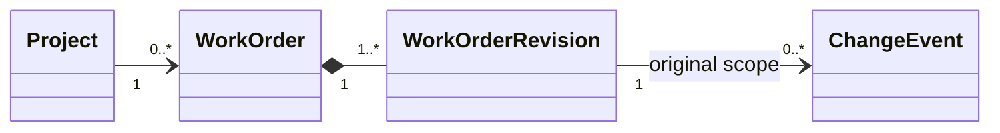
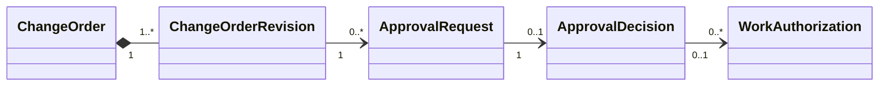
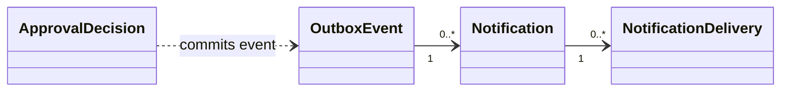

# Core associations - editable UML source

The specification uses fixed images for consistent layout. These three separate Mermaid diagrams provide editable source for the same associations.

## Original scope and reporting

## Versioned proposal and client decision

Cross-view relationship: one ChangeEvent has zero or one ChangeOrder in the MVP.

## Asynchronous notification delivery

The dashed dependency represents work performed by the approval service in the decision transaction. Notifications do not determine approval status.
